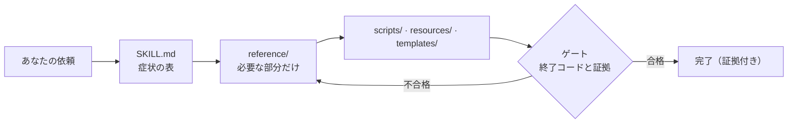

<div align="center">

<h1>unity-dev-skills</h1>

<p><b>Claude Code と Codex に慎重な Unity 開発者のように仕事をさせ、その一歩一歩を証明させる Unity 6 の skill 集。</b></p>

<p><i>最初のアイデアから、スマートフォンの実機で動くビルドまで。60 を超える skill。</i></p>

<p>
<a href="../.claude-plugin/plugin.json"></a>
<a href="https://github.com/tipoLi5890/unity-dev-skills/actions/workflows/ci.yml"></a>
<a href="../LICENSE"></a>


</p>

[繁體中文](README.zh-TW.md) · [简体中文](README.zh-CN.md) · **日本語** · [English](../README.md)


</div>

## こんなふうに頼めます

| 依頼 | 何が起きるか |
|---|---|
| 「ランナーのジャンプが、押しても出ないことがある」 | `unity-input` が押下を `Update` でラッチして `FixedUpdate` で一度だけ消費し、一回押せば一回跳ぶことを journey test で証明します |
| 「見張りが壁越しにランナーを見つけてくる」 | `unity-game-ai` が距離・角度・一回の視線キャストから視界コーンを作り、視認してから初めて追跡が始まることを journey で証明します |
| 「3 個目のピックアップが出るときにカクつく」 | `unity-profiling` がその瞬間を 90 フレームの窓（中央値、p95、最悪値）でサンプリングし、処理量と GC のカウンターを読んで前後を比べます |
| 「このランナーの絵を、Unity で走るキャラクターにして」 | `game-character-pipeline` がまず品質目標とルートを決め、S0–S13 の各工程（ビュー、3D、リグ、モーション、インポート）を、それぞれを担当する skill へゲート付きで渡します |
| 「コードを書く前に、クーリエランを見せて」 | `unity-game-brief` がゲーム自身のルール定数から時間軸どおりに進む模擬ゲームプレイのプレビューを作り、鳴った音をすべて記録します |
| 「Xcode は開かずに、iPhone に入れて」 | `unity-ios-build` がヘッドレスビルドとコンパイルゲートを実行し、Mac にあるもので署名して `devicectl` でインストールし、アプリのコンソールを読みます |

## インストール

```bash
claude plugin marketplace add tipoLi5890/unity-dev-skills
claude plugin install unity-dev@unity-dev
```

**Codex** も同じツリーを読みます。`.agents/plugins/marketplace.json` を指定するか、plugin 単体なら `.codex-plugin/plugin.json` を指定してください。どちらも Claude 形式のマニフェストから生成されるので、内容が食い違うことはありません。

**コピーして使う**こともできます。skill をプロジェクトへ直接入れるには、`skills/*` を `<project>/.claude/skills/` へコピーしてください。

### 必要なもの

- **必須**：Claude Code または Codex、Unity 6 のプロジェクト、スクリプト用の Python 3.10 以降（画像や音声を読むスクリプトには NumPy と Pillow も）。
- **任意**（アセットとキャラクターのパイプラインのみ）：お使いの Auto-Rig Pro のリリースが対応するバージョンの Blender（詳しくは `character-autorig`）、ご自身のライセンスで使う Auto-Rig Pro、GPU マシン上のセルフホスト ComfyUI、2D アート用の `codex` CLI。
- **任意**（動画）：動画を書き出すもの（プレビュー、リール、動画からのスプライト）には ffmpeg。
- **任意**（デバイス）：iOS には Xcode 15 以降を入れた Mac、Android には Android SDK。

Unity の中での作業には、アセットパイプラインや動画のツールはどれも要りません。スマートフォン向けのビルドに要るのは、そのプラットフォームがもともと求めるものだけです。

## 実際の動き

### 一枚の絵から、動くリグ付きキャラクターへ

<div align="center">

<p><sub>上：生成した二台カメラの動画。下：そこから推定したモーションで動くキャラクターのリグ。</sub></p>
</div>

[`codex-visual`](../skills/codex-visual/SKILL.md) →
[`comfyui-asset-generation`](../skills/comfyui-asset-generation/SKILL.md) →
[`character-autorig`](../skills/character-autorig/SKILL.md) →
[`humanoid-motion`](../skills/humanoid-motion/SKILL.md) →
[`unity-rigged-character`](../skills/unity-rigged-character/SKILL.md)

3D モデル、リグ、モーションは自分のマシンで作ります。`codex` CLI を通るのは 2D アートだけです。二台カメラからのモーション推定は [anymove](https://github.com/patch-gg/anymove)（Apache-2.0、[THIRD_PARTY_NOTICES.md](../THIRD_PARTY_NOTICES.md) を参照）から移植したものです。動画は MiniMax H3 で機械生成したもので、オープンウェイトを MiniMax H3 Community License Agreement のもとローカルで実行しています。

## 仕組み



- **言葉から正しい手順にたどり着きます**。各 skill は平易な言葉で書いた症状の表から始まり、三つの「まずここから」の skill がゲームプレイ・UI・キャラクターの依頼を振り分けます。
- **助言ではなく、コードを動かします**。100 を超える Python スクリプト、170 を超える C# ファイル、50 を超えるテンプレートを、メモを打ち直す代わりにプロジェクトへコピーして使います。
- **証明します**。手順の最後には、読んで確かめられるチェックがあります：probe スナップショット、journey test、再インポートした FBX、端末のログ。
- **コンテキストが軽く、自己完結しています**。`SKILL.md` は振り分けるだけで、詳しい内容は状況が必要とするときに読み込まれます。ほかの plugin は要りません。skill 同士は Scope の節を通じて互いに引き継ぎます。

## Skill 一覧

> [!TIP]
> どこから始めればよいか迷ったら、ゲームプレイの依頼には `unity-gameplay`、UI の依頼には `unity-game-ui`、画像からリグ付きキャラクターを作るなら `game-character-pipeline` を使ってください。

<details>
<summary><b>全ステージ共通 —— ターミナルと検索</b>：Unity CLI と、プロジェクト内で何でも探すこと</summary>

| Skill | 使うとき |
|---|---|
| [`unity-cli`](../skills/unity-cli/SKILL.md) | ターミナルから Unity を動かす。リトライしてよいかを終了コードが示す |
| [`unity-search`](../skills/unity-search/SKILL.md) | 「どこにある？何が参照している？」に、一本の Unity Search クエリで答える |

</details>

<details>
<summary><b>コンセプト</b>：ブリーフ、初日のプロジェクト設定、ゲームプレイの振り分け</summary>

| Skill | 使うとき |
|---|---|
| [`unity-game-brief`](../skills/unity-game-brief/SKILL.md) | アイデアを、ブリーフ、固定した見た目、ゲームプレイのプレビュー、遊べる一つのインタラクションにする |
| [`unity-new-project`](../skills/unity-new-project/SKILL.md) | 後から直すと高くつく初日の決定と、Editor なしで走るテスト |
| [`unity-gameplay`](../skills/unity-gameplay/SKILL.md) | ゲームプレイの依頼は**まずここから**。プロジェクトのフィンガープリントを取り、作業を振り分ける |

</details>

<details>
<summary><b>3C プロトタイプ</b>：入力、カメラ、2D と 3D のコントローラー、アニメーション、物理、プレイハーネス</summary>

| Skill | 使うとき |
|---|---|
| [`unity-input`](../skills/unity-input/SKILL.md) | 出なかったり二度出たりするジャンプ。ゲームプレイは一つの入力 struct だけを読む |
| [`unity-camera`](../skills/unity-camera/SKILL.md) | ガタつく、レベルの外を映す、壁を突き抜けるカメラ |
| [`unity-2d-controller`](../skills/unity-2d-controller/SKILL.md) | 坂を滑り落ちる、壁に張り付く 2D キャラクター。キネマティックなモーターを一つに |
| [`unity-3d-controller`](../skills/unity-3d-controller/SKILL.md) | `isGrounded` がちらつく、フレームレートでジャンプの高さが変わる。3D のモーターを一つに |
| [`unity-animation`](../skills/unity-animation/SKILL.md) | ステートから抜けない Animator、勝手に再生される攻撃 |
| [`unity-physics-2d`](../skills/unity-physics-2d/SKILL.md) | 発火しない 2D の衝突やトリガーを、Box2D 自身の語彙でトリアージ |
| [`unity-physics-3d`](../skills/unity-physics-3d/SKILL.md) | 発火しない衝突やトリガー、またはゲーム自身が積分するボール |
| [`unity-play-harness`](../skills/unity-play-harness/SKILL.md) | ゲームを操作できるようにする：一行の probe スナップショットと、不変条件をアサートする journey test |

</details>

<details>
<summary><b>バーティカルスライス —— 2D ワールド</b>：データとしてのレベル、グリッド盤面、タイルパレット、描画順と 2D ライト</summary>

| Skill | 使うとき |
|---|---|
| [`unity-2d-level`](../skills/unity-2d-level/SKILL.md) | データとしての 2D レベル。シード生成で、すべてのピックアップに到達できるか確かめる |
| [`unity-2d-grid`](../skills/unity-2d-grid/SKILL.md) | 正方形・アイソメトリック・ヘックスのグリッドで動く、タクティクスやタイルパズルの盤面ロジック |
| [`unity-tilemap`](../skills/unity-tilemap/SKILL.md) | 描いてもつながらないタイル。手持ちのシートから RuleTile を作り、グリッドごとにパレットを用意 |
| [`unity-2d-rendering`](../skills/unity-2d-rendering/SKILL.md) | 前後が逆に描かれるスプライト、すべてを黒くしてしまう `Light2D` |

</details>

<details>
<summary><b>バーティカルスライス —— 3D ワールド</b>：メトリクスどおりのグレーボックス、URP のライティング、NavMesh のエージェント</summary>

| Skill | 使うとき |
|---|---|
| [`unity-3d-level`](../skills/unity-3d-level/SKILL.md) | メトリクス表から組み、歩行 journey で証明する 3D のグレーボックス |
| [`unity-lighting`](../skills/unity-lighting/SKILL.md) | URP で、何も変わらないベイクや、ベイクした壁の横で真っ黒になるキャラクター |
| [`unity-navigation`](../skills/unity-navigation/SKILL.md) | 動かない、壁を抜けて歩くエージェント：NavMesh、リンク、Transform の所有権 |

</details>

<details>
<summary><b>バーティカルスライス —— システム</b>：ドアとピックアップ、ダメージ、敵 AI、シーンとセーブ</summary>

| Skill | 使うとき |
|---|---|
| [`unity-interaction`](../skills/unity-interaction/SKILL.md) | ちらつく、二度開く「E で開ける」。対象は一つ、プロンプトも一つ |
| [`unity-combat`](../skills/unity-combat/SKILL.md) | 二回当たる一振り、見張りをすり抜ける弾。ヒットは一回ずつ |
| [`unity-game-ai`](../skills/unity-game-ai/SKILL.md) | 壁越しに見つけてくる、決して諦めない敵。予算内に収める知覚 |
| [`unity-scene-flow`](../skills/unity-scene-flow/SKILL.md) | 二重になったマネージャー、壊れたセーブ。Boot シーンと、バージョン付きのアトミックなセーブ |

</details>

<details>
<summary><b>バーティカルスライス —— UI</b>：UI の振り分けと HUD、uGUI、UI Toolkit</summary>

| Skill | 使うとき |
|---|---|
| [`unity-game-ui`](../skills/unity-game-ui/SKILL.md) | UI の依頼は**まずここから**。UI システムを判定して振り分ける |
| [`unity-ui-ugui`](../skills/unity-ui-ugui/SKILL.md) | 何も描かない Canvas UI。六つのチェックのあと、アンカーと Layout Group |
| [`unity-ui-toolkit`](../skills/unity-ui-toolkit/SKILL.md) | 黙って何もしない USS プロパティ。UXML、flex レイアウト、バインディングも |

</details>

<details>
<summary><b>量産 —— アセット</b>：アセット台帳、3D モデル、リグ付きキャラクター、スプライト、オーディオ、多言語</summary>

| Skill | 使うとき |
|---|---|
| [`art-asset-registry`](../skills/art-asset-registry/SKILL.md) | 生成したアセットがどこから来て、どれが古くなったか。追記専用の台帳一つで追う |
| [`unity-3d-models`](../skills/unity-3d-models/SKILL.md) | 3D モデルをゲームへ。予算はゲームカメラで見て選ぶ |
| [`unity-rigged-character`](../skills/unity-rigged-character/SKILL.md) | Unity で T ポーズになるリグ付き FBX：インポート、Avatar、Animator、ゲームプレイ用リグ |
| [`unity-2d-sprites`](../skills/unity-2d-sprites/SKILL.md) | スクリプトでスライスするスプライトシートと、再生できるクリップにするコマ |
| [`unity-2d-animation`](../skills/unity-2d-animation/SKILL.md) | PSB から作るスケルタル 2D キャラクター。スキンと装備はランタイムで切り替え |
| [`unity-2d-pixel-perfect`](../skills/unity-2d-pixel-perfect/SKILL.md) | ぼける、カメラが動くとちらつく、継ぎ目が出るドット絵 |
| [`unity-sprite-atlas`](../skills/unity-sprite-atlas/SKILL.md) | 同じドローコールに載せたいスプライトを、スクリプトから V2 アトラスにパック |
| [`unity-audio`](../skills/unity-audio/SKILL.md) | ゲームの音を悪くせずに、オーディオのメモリと CPU を削る。再インポートの前に報告する |
| [`unity-localization`](../skills/unity-localization/SKILL.md) | 複数言語での出荷。破綻しやすい箇所である CJK フォントのパイプラインも含めて |

</details>

<details>
<summary><b>量産 —— AI アセット生成</b>：キャラクターの工程順、2D アート、オーディオ・動画・3D、リグとモーション</summary>

| Skill | 使うとき |
|---|---|
| [`game-character-pipeline`](../skills/game-character-pipeline/SKILL.md) | 画像からリグ付きキャラクターを作るなら**まずここから**。S0–S13 の各工程に、それぞれゲート |
| [`codex-visual`](../skills/codex-visual/SKILL.md) | `codex` の画像モデルで作る 2D アート。一冊のアートバイブルでスタイルを保つ |
| [`comfyui-asset-generation`](../skills/comfyui-asset-generation/SKILL.md) | 自前の ComfyUI で作る音楽、効果音、動画、3D モデル。それぞれ一つのジョブで |
| [`sprite-from-video`](../skills/sprite-from-video/SKILL.md) | キャラクターの静止画一枚を、生成した動画を通して透過スプライトのループにする |
| [`blender-character-rig`](../skills/blender-character-rig/SKILL.md) | 画像から 3D にしたキャラクターを Blender でリグ付けし、FBX は再インポートで証明 |
| [`blender-retarget`](../skills/blender-retarget/SKILL.md) | 既製のクリップを自分の Blender のリグへ。足滑り、ジッター、ポップでゲート |
| [`character-autorig`](../skills/character-autorig/SKILL.md) | 自分の Auto-Rig Pro で、人型をローカルでリグ付け。ヘッドレスのコマンド一つで |
| [`humanoid-motion`](../skills/humanoid-motion/SKILL.md) | 動きを一本のクリップに。二台カメラの動画から、骨格へ直接推定する |

</details>

<details>
<summary><b>仕上げと最適化</b>：ゲームフィール、URP、移行、プロファイリング、シーンのコスト、検証</summary>

| Skill | 使うとき |
|---|---|
| [`unity-game-feel`](../skills/unity-game-feel/SKILL.md) | 手応えのないヒット。ゲームプレイのイベントごとに、予算付きのフィードバック行を一つ |
| [`unity-render-urp`](../skills/unity-render-urp/SKILL.md) | 出てこないポストプロセスと、出荷前にレビューする Render Graph の機能 |
| [`unity-urp-migration`](../skills/unity-urp-migration/SKILL.md) | Built-in から URP へ、ゲート付きの五つのフェーズで。途中まで移行したプロジェクトの診断も |
| [`unity-profiling`](../skills/unity-profiling/SKILL.md) | 遅いフレーム、ばらつくフレームが何をしているか。比べられる 90 フレームの窓で |
| [`unity-scene-optimisation`](../skills/unity-scene-optimisation/SKILL.md) | カウンターがコストを特定したあとの修正。同じカウンターで読み戻す |
| [`unity-debug`](../skills/unity-debug/SKILL.md) | 目に見えない変更の検証。まずハーネスが本当のことを言っていると証明してから |

</details>

<details>
<summary><b>出荷</b>：実機テスト、Android、iOS、Web</summary>

| Skill | 使うとき |
|---|---|
| [`unity-device-testing`](../skills/unity-device-testing/SKILL.md) | 実機のスマートフォンでの受け入れ。エージェントが操作し、物理的な手順は人が行う |
| [`unity-android-release`](../skills/unity-android-release/SKILL.md) | 署名済みの APK または AAB。成果物を読み返して証明する |
| [`unity-ios-build`](../skills/unity-ios-build/SKILL.md) | Xcode を開かずに、Unity プロジェクトを iPhone で動くアプリにする |
| [`unity-web-release`](../skills/unity-web-release/SKILL.md) | 待ってもらえるほど小さく速い WebGL／WebGPU ビルド |

</details>

<details>
<summary><b>バックエンドと収益化</b>：バックエンドの規律、Gaming Services、課金、広告、マルチプレイヤー、ボイス</summary>

| Skill | 使うとき |
|---|---|
| [`unity-live-services`](../skills/unity-live-services/SKILL.md) | ゲームを安全にバックエンドへ載せる。オフライン経路を先に設計して |
| [`unity-ugs`](../skills/unity-ugs/SKILL.md) | 何も初期化されておらず例外を投げるサービス。Gaming Services を正しい順で |
| [`unity-iap`](../skills/unity-iap/SKILL.md) | 二重に、あるいはまったく付与されないコンテンツ。In-App Purchasing v5 を呼び出し単位で |
| [`unity-ads-levelplay`](../skills/unity-ads-levelplay/SKILL.md) | 広告が出ない、広告の依存でビルドが壊れる。LevelPlay で、初期化より前に同意を取る |
| [`unity-monetization`](../skills/unity-monetization/SKILL.md) | ビルド、マニフェスト、ストアでの申告を壊す課金・広告 SDK |
| [`unity-multiplayer`](../skills/unity-multiplayer/SKILL.md) | まずトポロジーを選ぶ。ボイスチャットがほかの機能のマイクを奪わないようにする |
| [`unity-multiplayer-services`](../skills/unity-multiplayer-services/SKILL.md) | プレイヤーが同じゲームに入るまで。参加コードからホスト移行まで |
| [`unity-vivox`](../skills/unity-vivox/SKILL.md) | 参加は成功したのに誰にも聞こえないボイス。Vivox のチャットを、サインインからプッシュトゥトークまで |

</details>

## コントリビュート

ツール、チェック、リポジトリのルール：[CONTRIBUTING.md](CONTRIBUTING.md)。各リリースの内容：[CHANGELOG.md](../CHANGELOG.md)。

## ライセンス

ライセンスは MIT です。詳しくは [LICENSE](../LICENSE) を参照してください。他のプロジェクトから移植したコードは、それぞれ元のライセンスのままです：[THIRD_PARTY_NOTICES.md](../THIRD_PARTY_NOTICES.md)。
