<div align="center">

<h1>unity-dev-skills</h1>

<p><b>Claude Code と Codex に慎重な Unity 開発者のように仕事をさせ、その一歩一歩を証明させる Unity 6 の skill 集。</b></p>

<p><i>最初のアイデアから、スマートフォンの実機で動くビルドまで。61 の skill。</i></p>

<p>
<a href="../.claude-plugin/plugin.json"></a>
<a href="https://github.com/tipoLi5890/unity-dev-skills/actions/workflows/ci.yml"></a>
<a href="../LICENSE"></a>


</p>

[繁體中文](README.zh-TW.md) · [简体中文](README.zh-CN.md) · **日本語** · [English](../README.md)

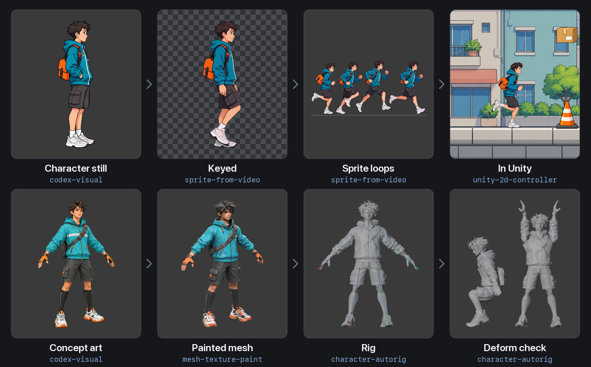

</div>

## こんなふうに頼めます

| 依頼 | 何が起きるか |
|---|---|
| 「ランナーのジャンプが、押しても出ないことがある」 | `unity-input` が押下を `Update` でラッチして `FixedUpdate` で一度だけ消費し、一回押せば一回跳ぶことを journey test で証明します |
| 「見張りが壁越しにランナーを見つけてくる」 | `unity-game-ai` が距離・角度・一回の視線キャストから視界コーンを作り、視認してから初めて追跡が始まることを journey で証明します |
| 「3 個目のピックアップが出るときにカクつく」 | `unity-profiling` がその瞬間を 90 フレームの窓（中央値、p95、最悪値）でサンプリングし、処理量と GC のカウンターを読んで前後を比べます |
| 「このランナーの絵を、Unity で走るキャラクターにして」 | `game-character-pipeline` がまず品質目標とルートを決め、S0–S13 の各工程（ビュー、3D、リグ、モーション、インポート）を、それぞれを担当する skill へゲート付きで渡します |
| 「歩哨をリグにして。ロングコートを着ている」 | `character-autorig` がスカートルートを通ります。コートの中の脚を一本ずつ股までたどり、コートのウェイトを腰と両方の太ももに分け、しゃがんで脚の間が裂ければリグを不合格にします |
| 「コードを書く前に、クーリエランを見せて」 | `unity-game-brief` がゲーム自身のルール定数から時間軸どおりに進む模擬ゲームプレイのプレビューを作り、鳴った音をすべて記録します |
| 「このランナーの静止画から、歩きのループを作って」 | `sprite-from-video` が動画モデルで静止画をその場で歩かせ、モデルが実際に塗ったキー色に合わせて全フレームを抜き、ループを計測で見つけて、同じキャンバスサイズのフレームと `frames.json` を書き出します |
| 「この警備員の絵をレイヤーに分けて、Unity でリグにして」 | `comfyui-asset-generation` が動く部位ごとに一枚のレイヤーに切り分け、腕に隠れた部分を描き足します。`unity-2d-animation` が Skinning Editor なしで PSB にボーン、メッシュ、ウェイトを書き込み、棒と盾は手についていきます |
| 「Xcode は開かずに、iPhone に入れて」 | `unity-ios-build` がヘッドレスビルドとコンパイルゲートを実行し、Mac にあるもので署名して `devicectl` でインストールし、アプリのコンソールを読みます |

## インストール

```bash
claude plugin marketplace add tipoLi5890/unity-dev-skills
claude plugin install unity-dev@unity-dev
```

**Codex** も同じツリーを読みます。`.agents/plugins/marketplace.json` を指定するか、plugin 単体なら `.codex-plugin/plugin.json` を指定してください。どちらも Claude 形式のマニフェストから生成されるので、内容が食い違うことはありません。

**コピーして使う**こともできます。skill をプロジェクトへ直接入れるには、`skills/*` を `<project>/.claude/skills/` へコピーしてください。

### 必要なもの

- **必須**：Claude Code または Codex、Unity 6 のプロジェクト、スクリプト用の Python 3.10 以降（画像や音声を読むスクリプトには NumPy と Pillow も）。
- **任意**（アセットとキャラクターのパイプラインのみ）：お使いの Auto-Rig Pro のリリースが対応するバージョンの Blender（詳しくは `character-autorig`）、Auto-Rig Pro（Artell による有料アドオンです。正規ライセンスを [Gumroad](https://artell.gumroad.com/l/auto-rig-pro) または [Superhive](https://superhivemarket.com/products/auto-rig-pro) でお求めください。開発とアップデートの支えになります。オプションの AI ファイルはライセンスに含まれ、1 ライセンスにつき 1 台で使えます）、GPU マシン上のセルフホスト ComfyUI、2D アート用の `codex` CLI、`mesh-texture-paint` と `comfyui-asset-generation` のパーツ、レイヤー、シーンのスクリプト用の SciPy。
- **任意**（動画）：動画を書き出すもの（プレビュー、リール、動画からのスプライト）には ffmpeg。
- **任意**（デバイス）：iOS には Xcode 15 以降を入れた Mac、Android には Android SDK。

Unity の中での作業には、アセットパイプラインや動画のツールはどれも要りません。スマートフォン向けのビルドに要るのは、そのプラットフォームがもともと求めるものだけです。

## 実際の動き

### コードを書く前にゲームを見る

<div align="center">
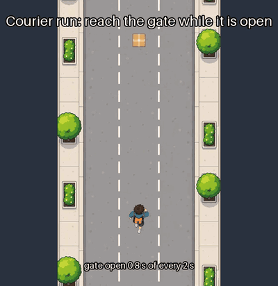
<p><sub>クーリエランの模擬ゲームプレイのプレビュー。ゲーム自身のアートで描いています。</sub></p>
</div>

[`unity-game-brief`](../skills/unity-game-brief/SKILL.md) →
[`codex-visual`](../skills/codex-visual/SKILL.md)

コードを書く前の段階で、ピックアップとゲートはすべてゲーム自身のルール定数からタイミングが決まり、イベントとして記録されます。

### 一枚の静止画から、Unity で走るスプライトへ

<div align="center">
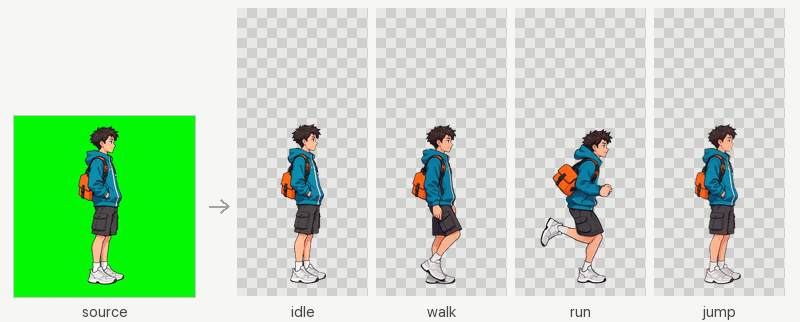
<p><sub>グリーンバックの静止画一枚から。呼吸するアイドルは静止画だけで作り、歩き・走り・ジャンプは生成した動画から切り出しています。</sub></p>
</div>

<div align="center">
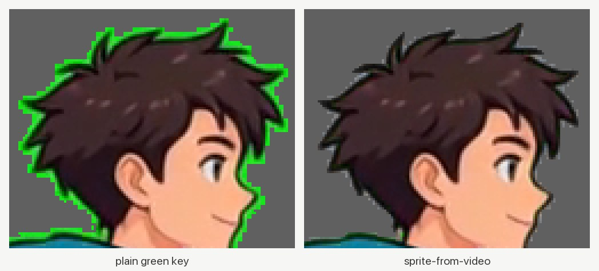
<p><sub>単純なグリーンキーでは緑の縁が残ります。<code>sprite-from-video</code> はモデルが実際に塗った緑に合わせて抜き、色かぶりを取り除きます。</sub></p>
</div>

<div align="center">
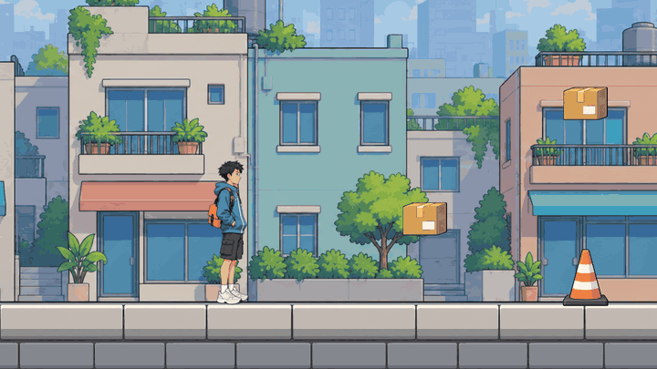
<p><sub>同じスプライトを Unity 6 で。ランナーはコーンをすべて跳び越え、荷物をすべて集め、ゲートを走り抜けます。</sub></p>
</div>

[`codex-visual`](../skills/codex-visual/SKILL.md) →
[`comfyui-asset-generation`](../skills/comfyui-asset-generation/SKILL.md) →
[`sprite-from-video`](../skills/sprite-from-video/SKILL.md) →
[`unity-2d-sprites`](../skills/unity-2d-sprites/SKILL.md) →
[`unity-2d-controller`](../skills/unity-2d-controller/SKILL.md)

### くすんだ生成テクスチャから、コンセプト通りのテクスチャへ

<div align="center">
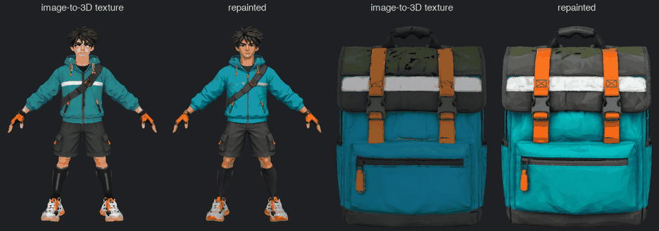
<p><sub>同じメッシュ、同じ UV。各組の左が画像から 3D で焼いたテクスチャ、右がコンセプト画から塗り直したテクスチャ。</sub></p>
</div>

<div align="center">
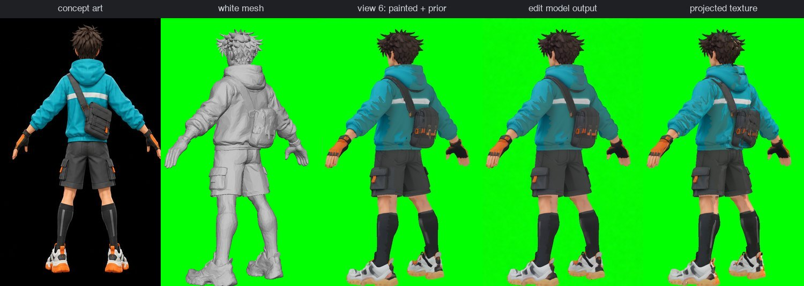
<p><sub>ループの一歩：ここまで塗った状態をレンダーし、ローカルの画像編集モデルがコンセプト画に合わせてその視点を塗り直し、ゲートを通ったものを UV テクスチャに投影して、次のカメラを選ぶ。</sub></p>
</div>

[`codex-visual`](../skills/codex-visual/SKILL.md) →
[`comfyui-asset-generation`](../skills/comfyui-asset-generation/SKILL.md) →
[`mesh-texture-paint`](../skills/mesh-texture-paint/SKILL.md)

画像から 3D は形はよくても色が濁る。ここではメッシュ、UV、焼いた法線と AO マップはそのままに、
ベースカラーだけを自分の ComfyUI でカメラ一つずつ塗り直す。各視点はテクスチャに書き込む前にレンダーと
照合し（輪郭、複数体のコラージュ、色ずれ、白っぽい背景）、頭部は寄りのパスで顔をくっきりさせる。

### 一枚の絵から、動くリグ付きキャラクターへ

<div align="center">
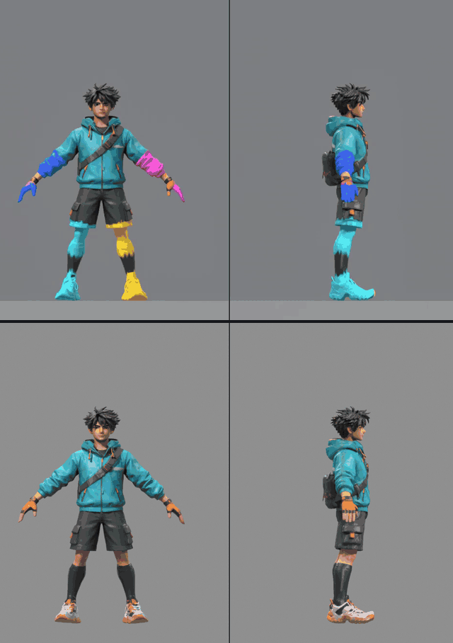
<p><sub>上：生成した二台カメラの動画。下：そこから推定したモーションで動くキャラクターのリグ。</sub></p>
</div>

[`codex-visual`](../skills/codex-visual/SKILL.md) →
[`comfyui-asset-generation`](../skills/comfyui-asset-generation/SKILL.md) →
[`mesh-texture-paint`](../skills/mesh-texture-paint/SKILL.md) →
[`character-autorig`](../skills/character-autorig/SKILL.md) →
[`humanoid-motion`](../skills/humanoid-motion/SKILL.md) →
[`unity-rigged-character`](../skills/unity-rigged-character/SKILL.md)

3D モデル、リグ、モーションは自分のマシンで作ります。`codex` CLI を通るのは 2D アートだけです。二台カメラからのモーション推定は [anymove](https://github.com/patch-gg/anymove)（Apache-2.0、[THIRD_PARTY_NOTICES.md](../THIRD_PARTY_NOTICES.md) を参照）から移植したものです。スプライトのクリップとモーションの動画は MiniMax H3 で機械生成したもので、オープンウェイトを MiniMax H3 Community License Agreement のもとローカルで実行しています。

### 走りについて揺れるバッグとフード

<div align="center">
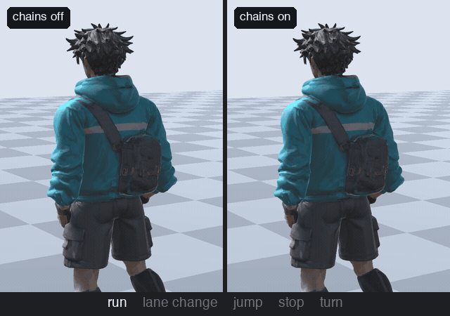
<p><sub>同じリグ、同じモーションを Unity で。左：チェーンなし。右：スプリングチェーンあり。</sub></p>
</div>

<div align="center">
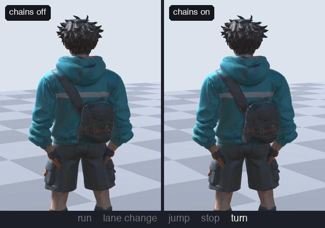
<p><sub>振り向きの最初の数コマ：チェーンありではバッグが体に遅れてついてくる。</sub></p>
</div>

[`character-autorig`](../skills/character-autorig/SKILL.md) →
[`unity-rigged-character`](../skills/unity-rigged-character/SKILL.md)

リグの工程でバッグ、フード、髪、上着の裾、ショートパンツ（ほかのキャラクターでは腰のバッグ、ロングコートの裾、マント）にボーンチェーンを加え、それぞれの硬さと体の位置を `<name>.secondary.json` に書き出します。Unity ではコマンド一つでスプリングボーンになり、どのフレームレートでも長さを保ち、体にめり込みません。

### 寄っても崩れない顔と手

<div align="center">
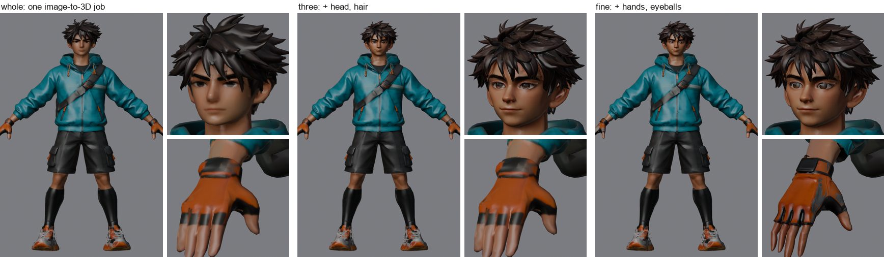
<p><sub>左：全身を一回で生成。中央：頭だけ別に生成。右：両手も別に生成し、動く眼球を入れたもの。</sub></p>
</div>

[`comfyui-asset-generation`](../skills/comfyui-asset-generation/SKILL.md) →
[`blender-character-rig`](../skills/blender-character-rig/SKILL.md) →
[`character-autorig`](../skills/character-autorig/SKILL.md)

顔が大事なキャラクターでは、頭をコンセプトから頭の大きさで描き直して別の部品として生成し、全身のメッシュに戻すので、比率は全身のままです。髪は三つ目のメッシュとして切り分け、首の継ぎ目は襟の中に隠して肌の色を合わせ、リグの工程で髪を頭に結び付けます。手を近くで見せるときは、両手をそれぞれ指の間をあけて生成し、袖口に差し込むので、リグがすべての指を見つけます。描かれた目の奥には眼球を入れ、目のボーンで回します。ゲーム用には部品を一つのメッシュと一枚のテクスチャアトラスにまとめ、描画は一回で済みます。

### ロングコートとちびキャラも、同じリグで

<div align="center">
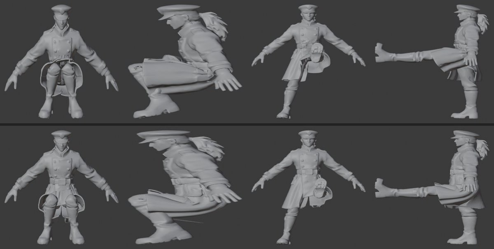
<p><sub>上：ズボンのようにウェイトを付けたコートは太ももの間で裂ける。下：スカートルートではコートがつながったまま、裾がそれぞれの脚についていく。</sub></p>
</div>

<div align="center">
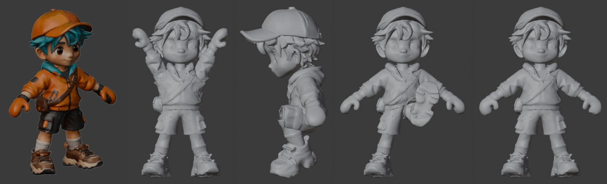
<p><sub>頭が身長の三分の一あるちびマスコット：腕を上げ、深くしゃがみ、膝を上げ、ミトンを握る。ミトンはひとかたまりで曲がります。</sub></p>
</div>

[`game-character-pipeline`](../skills/game-character-pipeline/SKILL.md) →
[`character-autorig`](../skills/character-autorig/SKILL.md) →
[`unity-rigged-character`](../skills/unity-rigged-character/SKILL.md)

体型は最初に人が選びます。ロングコートやスカートはスカートルート（`--body skirt`）を通り、リグはコートの中の脚を一本ずつ股までたどり、コートのウェイトを腰と両方の太ももに分け、裾には専用のスプリングチェーンを付け、脚の間でコートが裂ければ不合格にします。ちびキャラは専用のルート（`--body chibi`）で、大きな頭、短い首、太い手足に合わせた範囲とウィンドウを使い、上限は変えません。ミトンはひとかたまりとして読み、ひとかたまりで曲げます。リグへの変更はすべてリグ試験で採点します：関節の位置が分かっているシード付きの体と、各ゲートが必ず捕まえるべき仕込んだ欠陥です。

### 自分でリグが付く、レイヤー分けした 2D ランナー

<div align="center">
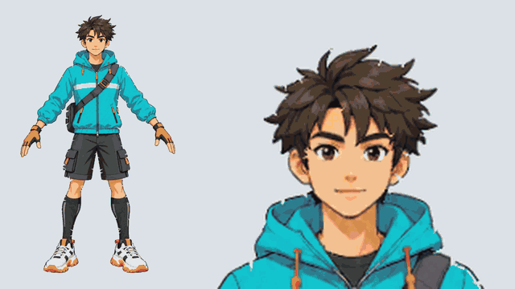
<p><sub>正面と横の絵を一枚ずつ、レイヤーに分けて Unity でリグを付けたもの：正面でまばたきとおしゃべり、横で視差スクロールする通りを走る。</sub></p>
</div>

<div align="center">
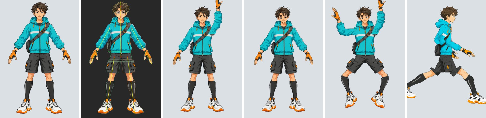
<p><sub>元の絵、そのレイヤーとボーン、そして元の絵にないポーズを取る Unity のリグ。</sub></p>
</div>

[`codex-visual`](../skills/codex-visual/SKILL.md) →
[`comfyui-asset-generation`](../skills/comfyui-asset-generation/SKILL.md) →
[`unity-2d-animation`](../skills/unity-2d-animation/SKILL.md) →
[`unity-2d-rendering`](../skills/unity-2d-rendering/SKILL.md)

絵は自分の ComfyUI で動く部位ごとに一枚のレイヤーに切り分けられ、腕や髪に隠れた部分は Qwen-Image-Edit が描き足し、Unity が PSB にボーン、メッシュ、ウェイトを書き込むので Skinning Editor の作業はいらず、通りは Qwen-Image-Layered が奥行きで分けて（どちらも Apache-2.0）視差スクロールにし、小物が自分のコピーと並ぶことはありません。同じレイヤーは Live2D Cubism にそのまま読み込める PSD としても出力され、Live2D のライセンスのもとで人が Cubism Editor でリグを組みます。

### 2D リグに小物とスケートボード

<div align="center">
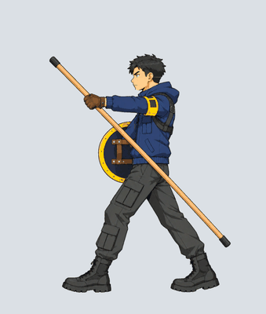 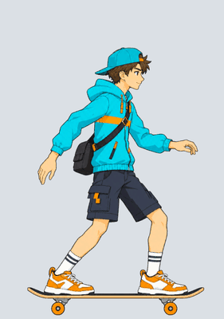
<p><sub>左：棒と盾がそれぞれ独立したレイヤーとして手についていく警備員。右：ボードに専用のボーンがあり、脚の IK がプッシュとオーリーの間も両足をボードに乗せておく配達員。</sub></p>
</div>

[`codex-visual`](../skills/codex-visual/SKILL.md) →
[`comfyui-asset-generation`](../skills/comfyui-asset-generation/SKILL.md) →
[`unity-2d-animation`](../skills/unity-2d-animation/SKILL.md)

小物は絵を切り分けるときに名前を付けます。手に持つ小物はその手の独立したレイヤーになり、腕に隠れた部分は小物自身の形から補います（丸い盾ならフィットさせた楕円から）。両足の下のボードには専用のボーンが付き、2 ボーンの脚 IK が足をボードに乗せ続けます。切り分けはゲートで確認し（小物に欠けを残さない、ボードは両方の靴底の下）、Unity のポーズも同様です：足がボードを踏み外したり、地面に沈んだりしません。

## 仕組み

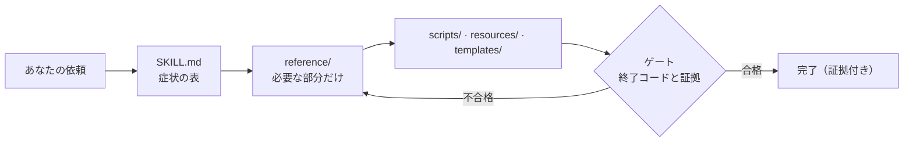

- **言葉から正しい手順にたどり着きます**。各 skill は平易な言葉で書いた症状の表から始まり、四つの「まずここから」の skill がゲームプレイ・UI・キャラクター・バックエンドの依頼を振り分けます。
- **助言ではなく、コードを動かします**。130 を超える Python スクリプト、200 を超える C# ファイル、50 を超えるテンプレートを、メモを打ち直す代わりにプロジェクトへコピーして使います。
- **証明します**。手順の最後には、読んで確かめられるチェックがあります：probe スナップショット、journey test、再インポートした FBX、端末のログ。
- **コンテキストが軽く、自己完結しています**。`SKILL.md` は振り分けるだけで、詳しい内容は状況が必要とするときに読み込まれます。ほかの plugin は要りません。skill 同士は Scope の節を通じて互いに引き継ぎます。リグとモーションの一部のスクリプトは隣の skill のスクリプトを呼び出します。一覧は [`tools/cross-skill-deps.txt`](../tools/cross-skill-deps.txt) にあり、これらの skill は一緒にインストールしてください。

## Skill 一覧

> [!TIP]
> どこから始めればよいか迷ったら、ゲームプレイの依頼には `unity-gameplay`、UI の依頼には `unity-game-ui`、画像からリグ付きキャラクターを作るなら `game-character-pipeline`、バックエンド・オンライン・収益化の依頼には `unity-live-services` を使ってください。

<details>
<summary><b>全ステージ共通 —— ターミナルと検索</b>：Unity CLI と、プロジェクト内で何でも探すこと</summary>

| Skill | 使うとき |
|---|---|
| [`unity-cli`](../skills/unity-cli/SKILL.md) | ターミナルから Unity を動かす。リトライしてよいかを終了コードが示す |
| [`unity-search`](../skills/unity-search/SKILL.md) | 「どこにある？何が参照している？」に、一本の Unity Search クエリで答える |

</details>

<details>
<summary><b>コンセプト</b>：ブリーフ、初日のプロジェクト設定、ゲームプレイの振り分け</summary>

| Skill | 使うとき |
|---|---|
| [`unity-game-brief`](../skills/unity-game-brief/SKILL.md) | アイデアを、ブリーフ、固定した見た目、ゲームプレイのプレビュー、遊べる一つのインタラクションにする |
| [`unity-new-project`](../skills/unity-new-project/SKILL.md) | 後から直すと高くつく初日の決定と、Editor なしで走るテスト |
| [`unity-gameplay`](../skills/unity-gameplay/SKILL.md) | ゲームプレイの依頼は**まずここから**。プロジェクトのフィンガープリントを取り、作業を振り分ける |

</details>

<details>
<summary><b>3C プロトタイプ</b>：入力、カメラ、2D と 3D のコントローラー、アニメーション、物理、プレイハーネス</summary>

| Skill | 使うとき |
|---|---|
| [`unity-input`](../skills/unity-input/SKILL.md) | 出なかったり二度出たりするジャンプ。ゲームプレイは一つの入力 struct だけを読む |
| [`unity-camera`](../skills/unity-camera/SKILL.md) | ガタつく、レベルの外を映す、壁を突き抜けるカメラ |
| [`unity-2d-controller`](../skills/unity-2d-controller/SKILL.md) | 坂を滑り落ちる、壁に張り付く 2D キャラクター。キネマティックなモーターを一つに |
| [`unity-3d-controller`](../skills/unity-3d-controller/SKILL.md) | `isGrounded` がちらつく、フレームレートでジャンプの高さが変わる。3D のモーターを一つに |
| [`unity-animation`](../skills/unity-animation/SKILL.md) | ステートから抜けない Animator、勝手に再生される攻撃 |
| [`unity-physics-2d`](../skills/unity-physics-2d/SKILL.md) | 発火しない 2D の衝突やトリガーを、Box2D 自身の語彙でトリアージ |
| [`unity-physics-3d`](../skills/unity-physics-3d/SKILL.md) | 発火しない衝突やトリガー、またはゲーム自身が積分するボール |
| [`unity-play-harness`](../skills/unity-play-harness/SKILL.md) | ゲームを操作できるようにする：一行の probe スナップショットと、不変条件をアサートする journey test |

</details>

<details>
<summary><b>バーティカルスライス —— 2D ワールド</b>：データとしてのレベル、グリッド盤面、タイルパレット、描画順と 2D ライト</summary>

| Skill | 使うとき |
|---|---|
| [`unity-2d-level`](../skills/unity-2d-level/SKILL.md) | データとしての 2D レベル。シード生成で、すべてのピックアップに到達できるか確かめる |
| [`unity-2d-grid`](../skills/unity-2d-grid/SKILL.md) | 正方形・アイソメトリック・ヘックスのグリッドで動く、タクティクスやタイルパズルの盤面ロジック |
| [`unity-tilemap`](../skills/unity-tilemap/SKILL.md) | 描いてもつながらないタイル。手持ちのシートから RuleTile を作り、グリッドごとにパレットを用意 |
| [`unity-2d-rendering`](../skills/unity-2d-rendering/SKILL.md) | 前後が逆に描かれるスプライト、すべてを黒くしてしまう `Light2D`、視差背景 |

</details>

<details>
<summary><b>バーティカルスライス —— 3D ワールド</b>：メトリクスどおりのグレーボックス、URP のライティング、NavMesh のエージェント</summary>

| Skill | 使うとき |
|---|---|
| [`unity-3d-level`](../skills/unity-3d-level/SKILL.md) | メトリクス表から組み、歩行 journey で証明する 3D のグレーボックス |
| [`unity-lighting`](../skills/unity-lighting/SKILL.md) | URP で、何も変わらないベイクや、ベイクした壁の横で真っ黒になるキャラクター |
| [`unity-navigation`](../skills/unity-navigation/SKILL.md) | 動かない、壁を抜けて歩くエージェント：NavMesh、リンク、Transform の所有権 |

</details>

<details>
<summary><b>バーティカルスライス —— システム</b>：ドアとピックアップ、ダメージ、敵 AI、シーンとセーブ</summary>

| Skill | 使うとき |
|---|---|
| [`unity-interaction`](../skills/unity-interaction/SKILL.md) | ちらつく、二度開く「E で開ける」。対象は一つ、プロンプトも一つ |
| [`unity-combat`](../skills/unity-combat/SKILL.md) | 二回当たる一振り、見張りをすり抜ける弾。ヒットは一回ずつ |
| [`unity-game-ai`](../skills/unity-game-ai/SKILL.md) | 壁越しに見つけてくる、決して諦めない敵。予算内に収める知覚 |
| [`unity-scene-flow`](../skills/unity-scene-flow/SKILL.md) | 二重になったマネージャー、壊れたセーブ。Boot シーンと、バージョン付きのアトミックなセーブ |

</details>

<details>
<summary><b>バーティカルスライス —— UI</b>：UI の振り分けと HUD、uGUI、UI Toolkit</summary>

| Skill | 使うとき |
|---|---|
| [`unity-game-ui`](../skills/unity-game-ui/SKILL.md) | UI の依頼は**まずここから**。UI システムを判定して振り分ける |
| [`unity-ui-ugui`](../skills/unity-ui-ugui/SKILL.md) | 何も描かない Canvas UI。六つのチェックのあと、アンカーと Layout Group |
| [`unity-ui-toolkit`](../skills/unity-ui-toolkit/SKILL.md) | 黙って何もしない USS プロパティ。UXML、flex レイアウト、バインディングも |

</details>

<details>
<summary><b>量産 —— アセット</b>：アセット台帳、3D モデル、リグ付きキャラクター、スプライト、オーディオ、多言語</summary>

| Skill | 使うとき |
|---|---|
| [`art-asset-registry`](../skills/art-asset-registry/SKILL.md) | 生成したアセットがどこから来て、どれが古くなったか。追記専用の台帳一つで追う |
| [`unity-3d-models`](../skills/unity-3d-models/SKILL.md) | 3D モデルをゲームへ。予算はゲームカメラで見て選ぶ |
| [`unity-rigged-character`](../skills/unity-rigged-character/SKILL.md) | Unity で T ポーズになるリグ付き FBX：インポート、Avatar、Animator、ゲームプレイ用リグ |
| [`unity-2d-sprites`](../skills/unity-2d-sprites/SKILL.md) | スクリプトでスライスするスプライトシートと、再生できるクリップにするコマ |
| [`unity-2d-animation`](../skills/unity-2d-animation/SKILL.md) | PSB から作るスケルタル 2D キャラクター。小物と脚 IK も含めスクリプトでリグ付け、スキンと装備はランタイムで切り替え |
| [`unity-2d-pixel-perfect`](../skills/unity-2d-pixel-perfect/SKILL.md) | ぼける、カメラが動くとちらつく、継ぎ目が出るドット絵 |
| [`unity-sprite-atlas`](../skills/unity-sprite-atlas/SKILL.md) | 同じドローコールに載せたいスプライトを、スクリプトから V2 アトラスにパック |
| [`unity-audio`](../skills/unity-audio/SKILL.md) | ゲームの音を悪くせずに、オーディオのメモリと CPU を削る。再インポートの前に報告する |
| [`unity-localization`](../skills/unity-localization/SKILL.md) | 複数言語での出荷。破綻しやすい箇所である CJK フォントのパイプラインも含めて |

</details>

<details>
<summary><b>量産 —— AI アセット生成</b>：キャラクターの工程順、2D アート、オーディオ・動画・3D、リグとモーション</summary>

| Skill | 使うとき |
|---|---|
| [`game-character-pipeline`](../skills/game-character-pipeline/SKILL.md) | 画像からリグ付きキャラクターを作るなら**まずここから**。S0–S13 の各工程に、それぞれゲート |
| [`codex-visual`](../skills/codex-visual/SKILL.md) | `codex` の画像モデルで作る 2D アート。一冊のアートバイブルでスタイルを保つ。フレーム列のキャラクターの一貫性と動きを測り、人が見る前にレビューシートを事前チェックする |
| [`comfyui-asset-generation`](../skills/comfyui-asset-generation/SKILL.md) | 自前の ComfyUI で作る音楽、効果音、動画、3D モデル、レイヤー分けした 2D アート。それぞれ一つのジョブで |
| [`mesh-texture-paint`](../skills/mesh-texture-paint/SKILL.md) | 生成した 3D モデルのくすんだテクスチャを、コンセプトアートから一視点ずつ塗り直す。メッシュと UV はそのまま。メッシュがコンセプト画にどれだけ近いかも測る |
| [`sprite-from-video`](../skills/sprite-from-video/SKILL.md) | キャラクターの静止画一枚を、生成した動画を通して透過スプライトのループにする |
| [`blender-character-rig`](../skills/blender-character-rig/SKILL.md) | `character-autorig` が合わないときに Blender で手作りするリグ。FBX は再インポートで証明 |
| [`blender-retarget`](../skills/blender-retarget/SKILL.md) | 既製のクリップを自分の Blender のリグへ。足滑り、ジッター、ポップでゲート |
| [`character-autorig`](../skills/character-autorig/SKILL.md) | 自分の Auto-Rig Pro で、人型をローカルでリグ付け（ロングコートやちびキャラも）。コマンド一つで。繰り返し実行してリグの安定度を確かめられます（オプションの AI 検出は Blender のウィンドウを開きます） |
| [`humanoid-motion`](../skills/humanoid-motion/SKILL.md) | 動きを一本のクリップに。二台カメラの動画から、骨格へ直接推定する |

</details>

<details>
<summary><b>仕上げと最適化</b>：ゲームフィール、URP、移行、プロファイリング、シーンのコスト、検証</summary>

| Skill | 使うとき |
|---|---|
| [`unity-game-feel`](../skills/unity-game-feel/SKILL.md) | 手応えのないヒット。ゲームプレイのイベントごとに、予算付きのフィードバック行を一つ |
| [`unity-render-urp`](../skills/unity-render-urp/SKILL.md) | 出てこないポストプロセスと、出荷前にレビューする Render Graph の機能 |
| [`unity-urp-migration`](../skills/unity-urp-migration/SKILL.md) | Built-in から URP へ、ゲート付きの五つのフェーズで。途中まで移行したプロジェクトの診断も |
| [`unity-profiling`](../skills/unity-profiling/SKILL.md) | 遅いフレーム、ばらつくフレームが何をしているか。比べられる 90 フレームの窓で |
| [`unity-scene-optimisation`](../skills/unity-scene-optimisation/SKILL.md) | カウンターがコストを特定したあとの修正。同じカウンターで読み戻す |
| [`unity-debug`](../skills/unity-debug/SKILL.md) | 目に見えない変更の検証。まずハーネスが本当のことを言っていると証明してから |

</details>

<details>
<summary><b>出荷</b>：実機テスト、Android、iOS、Web</summary>

| Skill | 使うとき |
|---|---|
| [`unity-device-testing`](../skills/unity-device-testing/SKILL.md) | 実機のスマートフォンでの受け入れ。エージェントが操作し、物理的な手順は人が行う |
| [`unity-android-release`](../skills/unity-android-release/SKILL.md) | 署名済みの APK または AAB。成果物を読み返して証明する |
| [`unity-ios-build`](../skills/unity-ios-build/SKILL.md) | Xcode を開かずに、Unity プロジェクトを iPhone で動くアプリにする |
| [`unity-web-release`](../skills/unity-web-release/SKILL.md) | 待ってもらえるほど小さく速い WebGL／WebGPU ビルド |

</details>

<details>
<summary><b>バックエンドと収益化</b>：バックエンドの規律、Gaming Services、課金、広告、マルチプレイヤー、ボイス</summary>

| Skill | 使うとき |
|---|---|
| [`unity-live-services`](../skills/unity-live-services/SKILL.md) | バックエンド・オンライン・収益化の入口。オフライン経路、マルチプレイヤーのトポロジー、SDK とストア申告の境目 |
| [`unity-ugs`](../skills/unity-ugs/SKILL.md) | 何も初期化されておらず例外を投げるサービス。Gaming Services を正しい順で |
| [`unity-iap`](../skills/unity-iap/SKILL.md) | 二重に、あるいはまったく付与されないコンテンツ。In-App Purchasing v5 を呼び出し単位で |
| [`unity-ads-levelplay`](../skills/unity-ads-levelplay/SKILL.md) | 広告が出ない、広告の依存でビルドが壊れる。LevelPlay で、初期化より前に同意を取る |
| [`unity-multiplayer-services`](../skills/unity-multiplayer-services/SKILL.md) | プレイヤーが同じゲームに入るまで。参加コードからホスト移行まで |
| [`unity-vivox`](../skills/unity-vivox/SKILL.md) | 参加は成功したのに誰にも聞こえないボイス。Vivox のチャットを、サインインからプッシュトゥトークまで |

</details>

## コントリビュート

ツール、チェック、リポジトリのルール：[CONTRIBUTING.md](CONTRIBUTING.md)。各リリースの内容：[CHANGELOG.md](../CHANGELOG.md)。

## ライセンス

ライセンスは MIT です。詳しくは [LICENSE](../LICENSE) を参照してください。他のプロジェクトから移植したコードは、それぞれ元のライセンスのままです：[THIRD_PARTY_NOTICES.md](../THIRD_PARTY_NOTICES.md)。
