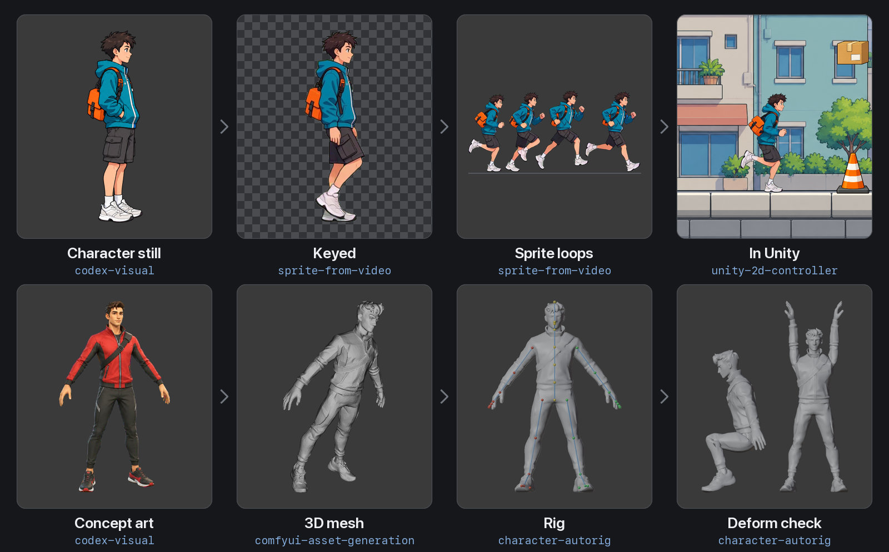
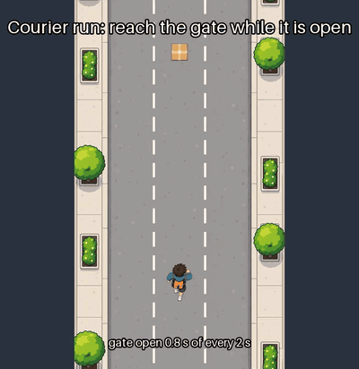
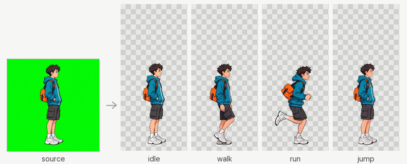
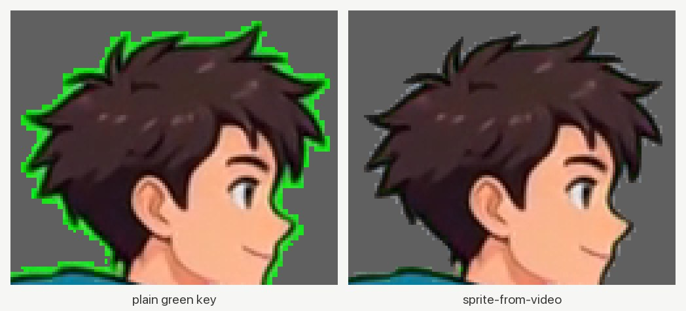
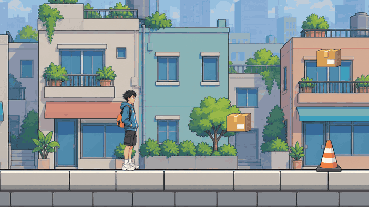
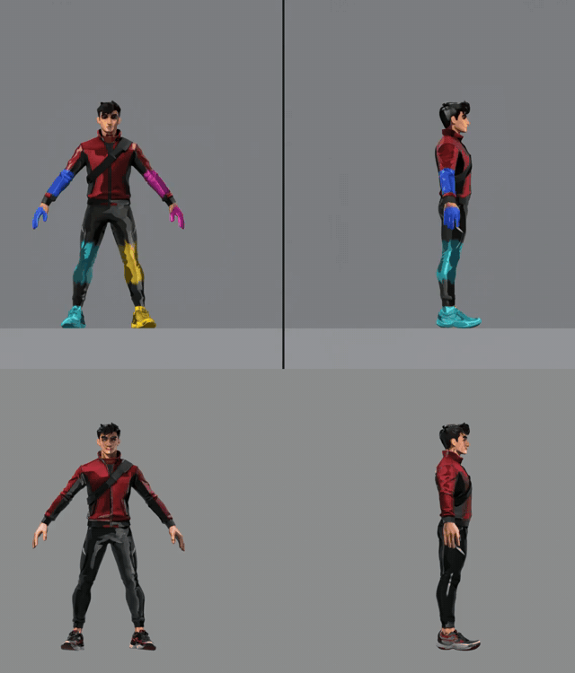
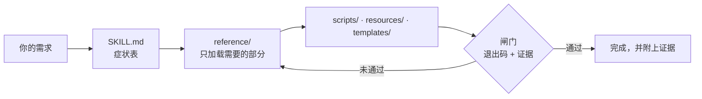

<div align="center">

<h1>unity-dev-skills</h1>

<p><b>让 Claude Code 和 Codex 像一位严谨的 Unity 开发者那样工作，并且每一步都拿出证据的 Unity 6 skills。</b></p>

<p><i>60 多个 skill，从最初的想法一直到真机上的构建。</i></p>

<p>
<a href="../.claude-plugin/plugin.json"></a>
<a href="https://github.com/tipoLi5890/unity-dev-skills/actions/workflows/ci.yml"></a>
<a href="../LICENSE"></a>


</p>

[繁體中文](README.zh-TW.md) · **简体中文** · [日本語](README.ja.md) · [English](../README.md)



</div>

## 试着这样问

| 你说 | 会发生什么 |
|---|---|
| “跑者的跳跃有时候按了没反应。” | `unity-input` 在 `Update` 里锁存每一次按键，在 `FixedUpdate` 里只消费一次，再用一个 journey 测试证明按一次就只跳一次 |
| “哨兵隔着墙也能看见跑者。” | `unity-game-ai` 用距离、角度和一次视线射线检测搭出视野锥；一个 journey 证明哨兵看见之后才开始追 |
| “第三个拾取物刷出来的时候会卡一下。” | `unity-profiling` 以 90 帧为一个窗口对那一刻采样（中位数、p95、最差值），读取工作量和 GC 计数器，并对比改动前后 |
| “把这张跑者的画稿做成能在 Unity 里跑起来的角色。” | `game-character-pipeline` 先定下质量目标和路线，再把 S0–S13 各阶段——多视图、3D、绑骨、动作、导入——交给各自负责的 skill，每一步都有闸门 |
| “写代码之前，先让我看看这趟送快递玩起来是什么样。” | `unity-game-brief` 用游戏自己的规则常量生成一段定时的模拟游玩预览，每个音效都记入日志 |
| “拿这张跑者的静态图给我做个走路循环。” | `sprite-from-video` 让视频模型把这张静态图原地走起来，每一帧都按模型实际画出的那种绿幕颜色来抠像，靠测量找出循环，再输出画布大小一致的逐帧图和 `frames.json` |
| “帮我装到 iPhone 上，不用打开 Xcode。” | `unity-ios-build` 执行无头构建、一道编译闸门、用你的 Mac 上现有的凭据签名、通过 `devicectl` 安装，并读取 App 的控制台输出 |

## 安装

```bash
claude plugin marketplace add tipoLi5890/unity-dev-skills
claude plugin install unity-dev@unity-dev
```

**Codex** 读取的是同一套目录：把它指向 `.agents/plugins/marketplace.json`；如果只要插件本身，就指向
`.codex-plugin/plugin.json`。这两份文件都由 Claude 格式的 manifest 生成，所以内容不可能对不上。

**也可以直接复制**：把 `skills/*` 复制到项目的 `<project>/.claude/skills/` 里。

### 环境要求

- **必需**：Claude Code 或 Codex；一个 Unity 6 项目；运行脚本需要 Python 3.10 或更高版本，读取图像或音频的脚本还需要
  NumPy 和 Pillow。
- **可选，仅用于资源与角色管线**：Blender，版本要在你所用的 Auto-Rig Pro 版本支持范围内（`character-autorig` 里有说明）；你自己持有许可的
  Auto-Rig Pro；部署在 GPU 机器上的自建 ComfyUI；用于 2D 美术的 `codex` CLI。
- **可选，用于视频**：ffmpeg，凡是要输出视频的功能都需要它（预览、集锦短片、由视频生成的 sprite）。
- **可选，用于设备**：iOS 需要一台装有 Xcode 15 或更高版本的 Mac；Android 需要 Android SDK。

在 Unity 里的工作用不到任何资源管线或视频工具；手机构建只需要该平台本来就要求的那些东西。

## 看看效果

### 写代码之前先看到游戏

<div align="center">

<p><sub>这趟送快递的模拟游玩预览，用的是游戏自己的美术。</sub></p>
</div>

[`unity-game-brief`](../skills/unity-game-brief/SKILL.md) →
[`codex-visual`](../skills/codex-visual/SKILL.md)

每一次拾取、每一道闸门的时间都取自游戏自己的规则常量，并作为事件记入日志，这时一行代码都还没写。

### 从一张静态图到在 Unity 里奔跑的 sprite

<div align="center">

<p><sub>一张绿幕静态图：只靠这张图做出带呼吸感的待机动画，走路、跑步和跳跃则从生成的视频中截取。</sub></p>
</div>

<div align="center">

<p><sub>普通的绿幕抠像会留下一圈绿边；<code>sprite-from-video</code> 按模型实际画出的那种绿色来抠像，并去掉溢色。</sub></p>
</div>

<div align="center">

<p><sub>同一套 sprite 放进 Unity 6：跑者跳过每一个锥桶，收集每一个包裹，并穿过闸门。</sub></p>
</div>

[`codex-visual`](../skills/codex-visual/SKILL.md) →
[`comfyui-asset-generation`](../skills/comfyui-asset-generation/SKILL.md) →
[`sprite-from-video`](../skills/sprite-from-video/SKILL.md) →
[`unity-2d-sprites`](../skills/unity-2d-sprites/SKILL.md) →
[`unity-2d-controller`](../skills/unity-2d-controller/SKILL.md)

### 从一张画稿到一个会动、绑好骨架的角色

<div align="center">

<p><sub>上：生成的双机位视频。下：角色的骨架，由从视频中解算出的动作驱动。</sub></p>
</div>

[`codex-visual`](../skills/codex-visual/SKILL.md) →
[`comfyui-asset-generation`](../skills/comfyui-asset-generation/SKILL.md) →
[`character-autorig`](../skills/character-autorig/SKILL.md) →
[`humanoid-motion`](../skills/humanoid-motion/SKILL.md) →
[`unity-rigged-character`](../skills/unity-rigged-character/SKILL.md)

3D 模型、骨架和动作都在你自己的机器上完成；只有 2D 美术会经过 `codex` CLI。双机位解算移植自
[anymove](https://github.com/patch-gg/anymove)（Apache-2.0；见 [THIRD_PARTY_NOTICES.md](../THIRD_PARTY_NOTICES.md)）。sprite 片段和动作视频都由 MiniMax H3 机器生成，基于其开放权重在本地运行，遵循 MiniMax H3 Community License Agreement。

## 工作原理



- **听懂你的描述，找到对的方法**：每个 skill 开头都有一张用日常语言写成的症状表，另有三个“从这里开始”的
  skill 负责分派任何玩法、UI 或角色需求。
- **跑的是代码，不是建议**：100 多个 Python 脚本、170 多个 C# 文件和 50 多个模板，直接复制进你的项目，不用照着笔记重敲。
- **拿出证据**：每个方法最后都有一项你能读懂的检查，比如探针快照、journey 测试、重新导入的 FBX、设备日志。
- **占用上下文少，自成一体**：`SKILL.md` 只负责路由，深入的内容等情况需要时才加载。不需要任何其他插件：skill 之间通过各自的 Scope 段落互相交接。

## Skill 一览

> [!TIP]
> 不知道从哪里开始？任何玩法需求用 `unity-gameplay`，任何 UI 需求用 `unity-game-ui`，从一张图做出绑骨角色用 `game-character-pipeline`。

<details>
<summary><b>所有阶段——终端与搜索</b>：Unity CLI，以及在项目里查找任何东西</summary>

| Skill | 什么时候用 |
|---|---|
| [`unity-cli`](../skills/unity-cli/SKILL.md) | 在终端里使用 Unity，退出码会告诉你这次重试是否站得住脚 |
| [`unity-search`](../skills/unity-search/SKILL.md) | “它在哪？谁引用了它？”用一条 Unity Search 查询来回答 |

</details>

<details>
<summary><b>概念</b>：简报、第一天的项目设置、玩法分派</summary>

| Skill | 什么时候用 |
|---|---|
| [`unity-game-brief`](../skills/unity-game-brief/SKILL.md) | 把一个想法变成一份简报、一套锁定的视觉风格、一段玩法预览和一个可玩的交互 |
| [`unity-new-project`](../skills/unity-new-project/SKILL.md) | 第一天就该定下、事后补救代价很高的决定，以及不开 Editor 也能跑的测试 |
| [`unity-gameplay`](../skills/unity-gameplay/SKILL.md) | 任何玩法需求都**从这里开始**：它先给项目做指纹识别，再分派工作 |

</details>

<details>
<summary><b>3C 原型</b>：输入、相机、2D 与 3D 控制器、动画、物理、play harness</summary>

| Skill | 什么时候用 |
|---|---|
| [`unity-input`](../skills/unity-input/SKILL.md) | 跳跃有时按了没反应，或者一下跳两次；玩法代码只读一个输入 struct |
| [`unity-camera`](../skills/unity-camera/SKILL.md) | 相机抖动、拍到关卡外面，或者穿墙 |
| [`unity-2d-controller`](../skills/unity-2d-controller/SKILL.md) | 2D 角色沿斜坡往下滑或者粘在墙上：一个 kinematic motor |
| [`unity-3d-controller`](../skills/unity-3d-controller/SKILL.md) | `isGrounded` 忽真忽假，或者跳跃高度随帧率变化：一个 3D motor |
| [`unity-animation`](../skills/unity-animation/SKILL.md) | Animator 卡在某个状态，或者攻击动画自己播了出来 |
| [`unity-physics-2d`](../skills/unity-physics-2d/SKILL.md) | 永远不触发的 2D 碰撞或 trigger，用 Box2D 自己的术语排查 |
| [`unity-physics-3d`](../skills/unity-physics-3d/SKILL.md) | 永远不触发的碰撞或 trigger，或者由游戏自己积分运动的球 |
| [`unity-play-harness`](../skills/unity-play-harness/SKILL.md) | 让游戏能被驱动：一行探针快照，以及断言不变量的 journey 测试 |

</details>

<details>
<summary><b>垂直切片——2D 世界</b>：数据化的关卡、网格棋盘、Tile Palette、绘制顺序与 2D 灯光</summary>

| Skill | 什么时候用 |
|---|---|
| [`unity-2d-level`](../skills/unity-2d-level/SKILL.md) | 把 2D 关卡当作数据，带种子的生成会检查每个拾取物都能到达 |
| [`unity-2d-grid`](../skills/unity-2d-grid/SKILL.md) | 方形、等距或六角网格上的战棋与方块解谜棋盘逻辑 |
| [`unity-tilemap`](../skills/unity-tilemap/SKILL.md) | 画的时候 tile 接不起来：用你自己的图生成 RuleTile，每个网格一套 palette |
| [`unity-2d-rendering`](../skills/unity-2d-rendering/SKILL.md) | sprite 被错误地画到了另一张后面，或者 `Light2D` 让整个画面变黑 |

</details>

<details>
<summary><b>垂直切片——3D 世界</b>：按度量搭白盒、URP 光照、NavMesh agent</summary>

| Skill | 什么时候用 |
|---|---|
| [`unity-3d-level`](../skills/unity-3d-level/SKILL.md) | 按度量表搭出的 3D 白盒，并用一段行走 journey 来证明 |
| [`unity-lighting`](../skills/unity-lighting/SKILL.md) | URP 上烘焙了却没有变化，或者角色在烘焙过的墙边一片黑 |
| [`unity-navigation`](../skills/unity-navigation/SKILL.md) | agent 不动或者穿墙：NavMesh、link，以及 transform 归谁管 |

</details>

<details>
<summary><b>垂直切片——系统</b>：门与拾取物、伤害、敌人 AI、场景与存档</summary>

| Skill | 什么时候用 |
|---|---|
| [`unity-interaction`](../skills/unity-interaction/SKILL.md) | “按 E 开门”的提示闪来闪去，或者门开了两次：一个目标，一个提示 |
| [`unity-combat`](../skills/unity-combat/SKILL.md) | 一次挥砍打中两次，或者子弹直接穿过哨兵：每次只算一次命中 |
| [`unity-game-ai`](../skills/unity-game-ai/SKILL.md) | 能隔着墙看见你，或者永远不放弃追击的敌人：有预算的感知 |
| [`unity-scene-flow`](../skills/unity-scene-flow/SKILL.md) | manager 重复出现，或者存档损坏：一个 Boot 场景，加上带版本号的原子存档 |

</details>

<details>
<summary><b>垂直切片——UI</b>：UI 分派与 HUD、uGUI、UI Toolkit</summary>

| Skill | 什么时候用 |
|---|---|
| [`unity-game-ui`](../skills/unity-game-ui/SKILL.md) | 任何 UI 需求都**从这里开始**：它会识别项目用的是哪套 UI 系统，再分派 |
| [`unity-ui-ugui`](../skills/unity-ui-ugui/SKILL.md) | Canvas UI 什么都不显示：先做六项检查，再看锚点和 Layout Group |
| [`unity-ui-toolkit`](../skills/unity-ui-toolkit/SKILL.md) | USS 属性悄无声息地不起作用，以及 UXML、flex 布局与数据绑定 |

</details>

<details>
<summary><b>量产——资源</b>：资源账本、3D 模型、绑骨角色、sprite、音频、多语言</summary>

| Skill | 什么时候用 |
|---|---|
| [`art-asset-registry`](../skills/art-asset-registry/SKILL.md) | 每个生成的资源从哪来、哪些已经过期：一份只增不改的账本 |
| [`unity-3d-models`](../skills/unity-3d-models/SKILL.md) | 把 3D 模型放进游戏，预算在游戏相机下挑选 |
| [`unity-rigged-character`](../skills/unity-rigged-character/SKILL.md) | 绑骨的 FBX 在 Unity 里一直摆着 T-pose：导入、Avatar、Animator 与 gameplay rig |
| [`unity-2d-sprites`](../skills/unity-2d-sprites/SKILL.md) | 用脚本切 sprite sheet，再把逐帧做成可播放的 clip |
| [`unity-2d-animation`](../skills/unity-2d-animation/SKILL.md) | 由 PSB 做出骨骼式 2D 角色，运行时切换皮肤和装备 |
| [`unity-2d-pixel-perfect`](../skills/unity-2d-pixel-perfect/SKILL.md) | 像素画显示发虚、镜头一动就闪烁，或者出现接缝 |
| [`unity-sprite-atlas`](../skills/unity-sprite-atlas/SKILL.md) | 本该共用一次 draw call 的 sprite，用脚本打包成 V2 图集 |
| [`unity-audio`](../skills/unity-audio/SKILL.md) | 削减音频的内存和 CPU 开销，又不让游戏听起来变差；重新导入之前先出报告 |
| [`unity-localization`](../skills/unity-localization/SKILL.md) | 用不止一种语言发布，包括容易出问题的 CJK 字体管线 |

</details>

<details>
<summary><b>量产——AI 资源生成</b>：角色的阶段顺序、2D 美术、音频、视频与 3D、绑骨与动作</summary>

| Skill | 什么时候用 |
|---|---|
| [`game-character-pipeline`](../skills/game-character-pipeline/SKILL.md) | 用一张图做绑骨角色，**从这里开始**：S0–S13 各阶段，每一阶段都有闸门 |
| [`codex-visual`](../skills/codex-visual/SKILL.md) | 通过 `codex` 图像模型出 2D 美术，用一份美术圣经保持风格统一 |
| [`comfyui-asset-generation`](../skills/comfyui-asset-generation/SKILL.md) | 用你自己的 ComfyUI 出音乐、音效、视频和 3D 模型，每种各一个任务 |
| [`sprite-from-video`](../skills/sprite-from-video/SKILL.md) | 通过一段生成的视频，把一张角色静态图变成透明的 sprite 循环 |
| [`blender-character-rig`](../skills/blender-character-rig/SKILL.md) | 在 Blender 里给图生 3D 的角色绑骨，导出的 FBX 用重新导入来验证 |
| [`blender-retarget`](../skills/blender-retarget/SKILL.md) | 把现成的动作 clip 套到你的 Blender 骨架上，按脚滑、抖动和跳变把关 |
| [`character-autorig`](../skills/character-autorig/SKILL.md) | 用你自己的 Auto-Rig Pro 在本地给人形角色绑骨，一条无头命令完成 |
| [`humanoid-motion`](../skills/humanoid-motion/SKILL.md) | 把一个动作做成 clip，从双机位视频直接解算到骨架上 |

</details>

<details>
<summary><b>打磨与优化</b>：游戏手感、URP、迁移、性能分析、场景开销、验证</summary>

| Skill | 什么时候用 |
|---|---|
| [`unity-game-feel`](../skills/unity-game-feel/SKILL.md) | 命中没有打击感：每个玩法事件一行反馈，并且有预算 |
| [`unity-render-urp`](../skills/unity-render-urp/SKILL.md) | 就是不出现的后处理，以及发布前审查 Render Graph 功能 |
| [`unity-urp-migration`](../skills/unity-urp-migration/SKILL.md) | 分五个带闸门的阶段从 Built-in 迁到 URP，或者诊断迁移到一半的项目 |
| [`unity-profiling`](../skills/unity-profiling/SKILL.md) | 一帧变慢或不稳时到底在做什么，以 90 帧窗口记录并对比 |
| [`unity-scene-optimisation`](../skills/unity-scene-optimisation/SKILL.md) | 计数器指出开销之后的修法，并在同一个计数器上读回结果 |
| [`unity-debug`](../skills/unity-debug/SKILL.md) | 验证一个你看不见的改动——前提是先证明 harness 说的是真话 |

</details>

<details>
<summary><b>发布</b>：真机测试、Android、iOS、Web</summary>

| Skill | 什么时候用 |
|---|---|
| [`unity-device-testing`](../skills/unity-device-testing/SKILL.md) | 在真机上验收：agent 负责驱动，真人只做物理操作的那一步 |
| [`unity-android-release`](../skills/unity-android-release/SKILL.md) | 签好名的 APK 或 AAB，通过读回产物来证明 |
| [`unity-ios-build`](../skills/unity-ios-build/SKILL.md) | 不打开 Xcode，把 Unity 项目变成在 iPhone 上运行的 App |
| [`unity-web-release`](../skills/unity-web-release/SKILL.md) | WebGL 或 WebGPU 构建足够小、足够快，让人愿意等它加载 |

</details>

<details>
<summary><b>后端与商业化</b>：后端规范、Gaming Services、内购、广告、多人联机、语音</summary>

| Skill | 什么时候用 |
|---|---|
| [`unity-live-services`](../skills/unity-live-services/SKILL.md) | 安全地把游戏接上后端，并先设计好离线路径 |
| [`unity-ugs`](../skills/unity-ugs/SKILL.md) | 服务因为没有初始化而抛异常：按正确的顺序初始化 Gaming Services |
| [`unity-iap`](../skills/unity-iap/SKILL.md) | 内容发了两次或者一次都没发：逐个调用讲清 In-App Purchasing v5 |
| [`unity-ads-levelplay`](../skills/unity-ads-levelplay/SKILL.md) | 广告不出现，或者广告依赖把构建弄坏：LevelPlay，初始化之前先取得同意 |
| [`unity-monetization`](../skills/unity-monetization/SKILL.md) | 内购和广告 SDK 弄坏了构建、manifest 或商店声明 |
| [`unity-multiplayer`](../skills/unity-multiplayer/SKILL.md) | 先选定网络拓扑，并且别让语音聊天抢走其他功能的麦克风 |
| [`unity-multiplayer-services`](../skills/unity-multiplayer-services/SKILL.md) | 玩家怎么进到同一局游戏，从加入码到主机迁移 |
| [`unity-vivox`](../skills/unity-vivox/SKILL.md) | 进了语音频道却没人听得见：Vivox 聊天，从登录到按键说话 |

</details>

## 参与贡献

工具、检查和仓库规则：[.github/CONTRIBUTING.md](CONTRIBUTING.md)。每个版本包含哪些内容：[CHANGELOG.md](../CHANGELOG.md)。

## 许可证

MIT——见 [LICENSE](../LICENSE)。移植自其他项目的代码保留各自的许可证：[THIRD_PARTY_NOTICES.md](../THIRD_PARTY_NOTICES.md)。
