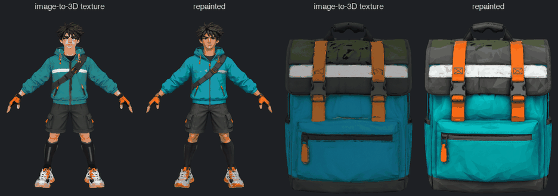
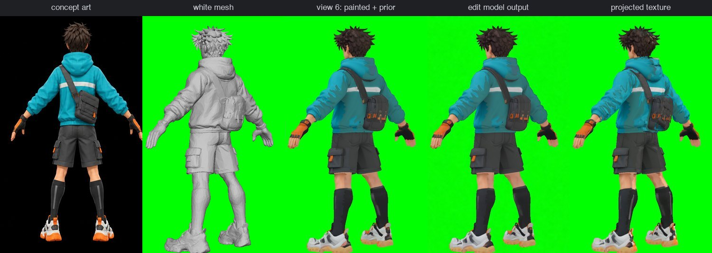
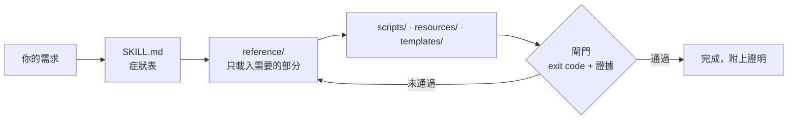

<div align="center">

<h1>unity-dev-skills</h1>

<p><b>一組 Unity 6 skill，讓 Claude Code 和 Codex 像謹慎的 Unity 開發者一樣做事，而且每一步都拿得出證明。</b></p>

<p><i>61 個 skill，從最初的構想一路到真機上的建置。</i></p>

<p>
<a href="../.claude-plugin/plugin.json"></a>
<a href="https://github.com/tipoLi5890/unity-dev-skills/actions/workflows/ci.yml"></a>
<a href="../LICENSE"></a>


</p>

**繁體中文** · [简体中文](README.zh-CN.md) · [日本語](README.ja.md) · [English](../README.md)


</div>

## 試著這樣問

| 你說 | 接下來會發生什麼 |
|---|---|
| 「跑者的跳躍有時候按了沒反應。」 | `unity-input` 在 `Update` 鎖存每一次按下、在 `FixedUpdate` 只消耗一次，再用一個 journey test 證明按一次正好跳一次 |
| 「哨兵隔著牆也看得到跑者。」 | `unity-game-ai` 用距離、角度和一次視線 cast 組出視野錐；一個 journey 證明要先看見，追擊才會開始 |
| 「第三個拾取物生出來的時候會卡一下。」 | `unity-profiling` 以 90 幀為一個視窗取樣那一刻（中位數、p95、最差值），讀出工作量與 GC 計數器，再比對改動前後 |
| 「把這張跑者的圖做成能在 Unity 裡跑起來的角色。」 | `game-character-pipeline` 先定好品質目標與路線，再把 S0–S13 各階段——多視角圖、3D、綁骨、動作、匯入——交給各自負責的 skill，每一段都有閘門把關 |
| 「寫程式之前，先讓我看看這趟送件玩起來是什麼樣子。」 | `unity-game-brief` 依遊戲自己的規則常數做出一段計時的模擬遊玩預覽，每個音效都記錄下來 |
| 「用這張跑者的靜態圖幫我做一段走路循環。」 | `sprite-from-video` 讓影片模型帶著這張靜態圖原地走路，每一格都依模型實際畫出的那種底色去背，靠量測找出循環點，輸出畫布尺寸一致的逐格圖和 `frames.json` |
| 「幫我裝到 iPhone 上，不要開 Xcode。」 | `unity-ios-build` 跑 headless 建置、過編譯閘門、用你這台 Mac 上現有的簽章資料簽章、以 `devicectl` 安裝，並讀取 App 的 console |

## 安裝

```bash
claude plugin marketplace add tipoLi5890/unity-dev-skills
claude plugin install unity-dev@unity-dev
```

**Codex** 讀的是同一棵目錄樹：把它指向 `.agents/plugins/marketplace.json`；只要 plugin 本身的話，就指向 `.codex-plugin/plugin.json`。兩份都由 Claude 格式的 manifest 生成，所以內容永遠不會分歧。

**或者直接複製** skill 到專案裡：把 `skills/*` 複製到 `<project>/.claude/skills/`。

### 需求

- **必要**：Claude Code 或 Codex；一個 Unity 6 專案；執行腳本需要 Python 3.10 以上，讀取圖片或音訊的腳本另需 NumPy 與 Pillow。
- **選用，只有資產與角色管線需要**：Blender，版本須是你那一版 Auto-Rig Pro 支援的（`character-autorig` 有說明）；Auto-Rig Pro，使用你自己的授權；在 GPU 機器上自架的 ComfyUI；做 2D 美術用的 `codex` CLI；`mesh-texture-paint` 需要的 SciPy。
- **選用，影片用**：ffmpeg，凡是要輸出影片的都需要（預覽、reel、由影片做成的 sprite）。
- **選用，裝置用**：iOS 需要一台裝有 Xcode 15 以上的 Mac；Android 需要 Android SDK。

在 Unity 裡工作，不需要任何資產管線或影片工具；手機建置只需要該平台本來就要求的東西。

## 實際效果

### 寫程式之前先看到遊戲

<div align="center">

<p><sub>這趟送件的模擬遊玩預覽，用的是遊戲自己的美術。</sub></p>
</div>

[`unity-game-brief`](../skills/unity-game-brief/SKILL.md) →
[`codex-visual`](../skills/codex-visual/SKILL.md)

每個拾取物和閘門的時機都依遊戲自己的規則常數計算，並記錄成事件，一行程式碼都還沒寫。

### 從一張靜態圖到在 Unity 裡奔跑的 sprite

<div align="center">

<p><sub>一張綠幕上的靜態圖：只用這張圖做出會呼吸的待機動畫，走路、跑步和跳躍則從生成的影片裁切出來。</sub></p>
</div>

<div align="center">

<p><sub>一般的綠幕去背會留下一圈綠邊；<code>sprite-from-video</code> 對照模型實際畫出的那種綠色去背，並把溢色清掉。</sub></p>
</div>

<div align="center">

<p><sub>同一批 sprite 放進 Unity 6：跑者跳過每一個三角錐、收集每一個包裹，然後跑過閘門。</sub></p>
</div>

[`codex-visual`](../skills/codex-visual/SKILL.md) →
[`comfyui-asset-generation`](../skills/comfyui-asset-generation/SKILL.md) →
[`sprite-from-video`](../skills/sprite-from-video/SKILL.md) →
[`unity-2d-sprites`](../skills/unity-2d-sprites/SKILL.md) →
[`unity-2d-controller`](../skills/unity-2d-controller/SKILL.md)

### 從灰暗的生成貼圖，到與概念圖一致的貼圖

<div align="center">

<p><sub>同樣的網格、同樣的 UV。每組左邊是圖生 3D 烘出的貼圖，右邊是依概念圖重新上色的貼圖。</sub></p>
</div>

<div align="center">

<p><sub>迴圈中的一步：渲染目前已上色的樣子，讓本地圖像編輯模型依概念圖重畫這個視角，通過閘門後投影回 UV 貼圖，再挑下一個鏡頭。</sub></p>
</div>

[`codex-visual`](../skills/codex-visual/SKILL.md) →
[`comfyui-asset-generation`](../skills/comfyui-asset-generation/SKILL.md) →
[`mesh-texture-paint`](../skills/mesh-texture-paint/SKILL.md)

圖生 3D 的形狀做得好，顏色卻混濁。這裡保留網格、UV 和烘好的法線與 AO 貼圖，只在你自己的 ComfyUI 上
一個鏡頭一個鏡頭地重畫 base color。每個視角寫進貼圖前都要和渲染圖比對（輪廓、多人拼貼、顏色漂移、
背景泛白），頭部另有近拍，讓臉更清楚。

### 從一張圖到會動的綁骨角色

<div align="center">

<p><sub>上：生成的雙機位影片。下：角色的骨架，由從影片解算出的動作驅動。</sub></p>
</div>

[`codex-visual`](../skills/codex-visual/SKILL.md) →
[`comfyui-asset-generation`](../skills/comfyui-asset-generation/SKILL.md) →
[`mesh-texture-paint`](../skills/mesh-texture-paint/SKILL.md) →
[`character-autorig`](../skills/character-autorig/SKILL.md) →
[`humanoid-motion`](../skills/humanoid-motion/SKILL.md) →
[`unity-rigged-character`](../skills/unity-rigged-character/SKILL.md)

3D 模型、骨架和動作都在你自己的機器上製作；只有 2D 美術會經過 `codex` CLI。雙機位解算移植自 [anymove](https://github.com/patch-gg/anymove)（Apache-2.0；見 [THIRD_PARTY_NOTICES.md](../THIRD_PARTY_NOTICES.md)）。sprite 片段與動作影片皆由 MiniMax H3 機器生成，依 MiniMax H3 Community License Agreement，在本地以其開放權重執行。

## 運作方式



- **從你的描述找到對的方法**。每個 skill 開頭都是一張用白話寫成的症狀表，另有四個「從這裡開始」的 skill 負責分派任何 gameplay、UI、角色或後端需求。
- **執行的是程式碼，不是建議**。100+ 支 Python 腳本、170+ 個 C# 檔案和 50+ 份範本，直接複製進你的專案，不用照著筆記重打。
- **拿得出證明**。每套方法都以一項你看得到的檢查收尾：probe 快照、journey test、重新匯入的 FBX、裝置 log。
- **少佔上下文，自成一體**。`SKILL.md` 只負責分派；深入的內容等情境需要時才載入。不需要任何其他 plugin：skill 之間透過各自的 Scope 段落互相交接。少數綁骨與動作腳本會呼叫相鄰 skill 的腳本，清單見 [`tools/cross-skill-deps.txt`](../tools/cross-skill-deps.txt)，這些 skill 要一起安裝。

## Skill 一覽

> [!TIP]
> 不知道從哪裡開始？任何 gameplay 需求用 `unity-gameplay`，任何 UI 需求用 `unity-game-ui`，要從圖片做出綁骨角色就用 `game-character-pipeline`，任何後端、連線或商業化需求用 `unity-live-services`。

<details>
<summary><b>每個階段——終端機與搜尋</b>：Unity CLI，以及在專案裡找出任何東西</summary>

| Skill | 什麼時候用 |
|---|---|
| [`unity-cli`](../skills/unity-cli/SKILL.md) | 從終端機操作 Unity，exit code 會告訴你重試是否合理 |
| [`unity-search`](../skills/unity-search/SKILL.md) | 「它在哪？誰引用了它？」用一條 Unity Search 查詢回答 |

</details>

<details>
<summary><b>概念</b>：企劃書、第一天的專案設定、gameplay 分派</summary>

| Skill | 什麼時候用 |
|---|---|
| [`unity-game-brief`](../skills/unity-game-brief/SKILL.md) | 把一個點子變成一份企劃書、一套定案的視覺風格、一段遊玩預覽、一個可以玩的互動 |
| [`unity-new-project`](../skills/unity-new-project/SKILL.md) | 第一天就該定下、事後補做代價很高的決策，外加不開 Editor 就能跑的測試 |
| [`unity-gameplay`](../skills/unity-gameplay/SKILL.md) | 任何 gameplay 需求都**從這裡開始**：它先辨識專案的特徵，再分派工作 |

</details>

<details>
<summary><b>3C 原型</b>：輸入、攝影機、2D 與 3D 控制器、動畫、物理、play harness</summary>

| Skill | 什麼時候用 |
|---|---|
| [`unity-input`](../skills/unity-input/SKILL.md) | 會漏掉或連發兩次的跳躍；gameplay 讀取單一輸入 struct |
| [`unity-camera`](../skills/unity-camera/SKILL.md) | 會抖動、拍到關卡外面或穿牆的攝影機 |
| [`unity-2d-controller`](../skills/unity-2d-controller/SKILL.md) | 沿斜坡滑下去或黏在牆上的 2D 角色：一個 kinematic motor |
| [`unity-3d-controller`](../skills/unity-3d-controller/SKILL.md) | `isGrounded` 忽真忽假，或跳躍高度隨幀率改變：一個 3D motor |
| [`unity-animation`](../skills/unity-animation/SKILL.md) | 卡在某個狀態的 Animator，或自己播出來的攻擊 |
| [`unity-physics-2d`](../skills/unity-physics-2d/SKILL.md) | 永遠不觸發的 2D 碰撞或 trigger，用 Box2D 自己的術語來診斷 |
| [`unity-physics-3d`](../skills/unity-physics-3d/SKILL.md) | 永遠不觸發的碰撞或 trigger，或是由遊戲自己積分的球 |
| [`unity-play-harness`](../skills/unity-play-harness/SKILL.md) | 讓遊戲可以被驅動：一行 probe 快照，以及斷言不變量的 journey test |

</details>

<details>
<summary><b>垂直切片——2D 世界</b>：以資料表示的關卡、網格棋盤、Tile Palette、繪製順序與 2D 光源</summary>

| Skill | 什麼時候用 |
|---|---|
| [`unity-2d-level`](../skills/unity-2d-level/SKILL.md) | 以資料表示的 2D 關卡，附種子生成，會檢查每個拾取物都到得了 |
| [`unity-2d-grid`](../skills/unity-2d-grid/SKILL.md) | 戰棋與方塊解謎的棋盤邏輯，支援方格、等角與六角網格 |
| [`unity-tilemap`](../skills/unity-tilemap/SKILL.md) | 畫的時候接不起來的 tile：用你的圖集產出 RuleTile，每個網格各一套 palette |
| [`unity-2d-rendering`](../skills/unity-2d-rendering/SKILL.md) | 前後順序畫錯的 sprite，或讓整個畫面變黑的 `Light2D` |

</details>

<details>
<summary><b>垂直切片——3D 世界</b>：照尺寸表蓋的 greybox、URP 光照、NavMesh agent</summary>

| Skill | 什麼時候用 |
|---|---|
| [`unity-3d-level`](../skills/unity-3d-level/SKILL.md) | 依尺寸表蓋出、再用行走 journey 證明的 3D greybox |
| [`unity-lighting`](../skills/unity-lighting/SKILL.md) | URP 上烘焙了卻沒變化，或角色在烘焙過的牆邊一片黑 |
| [`unity-navigation`](../skills/unity-navigation/SKILL.md) | 不肯動或直接穿牆走的 agent：NavMesh、link、transform 歸屬 |

</details>

<details>
<summary><b>垂直切片——系統</b>：門與拾取物、傷害、敵人 AI、場景與存檔</summary>

| Skill | 什麼時候用 |
|---|---|
| [`unity-interaction`](../skills/unity-interaction/SKILL.md) | 會閃爍或開兩次的「按 E 開啟」：一個目標、一個提示 |
| [`unity-combat`](../skills/unity-combat/SKILL.md) | 一次揮擊打中兩次，或子彈直接穿過哨兵：每次只算一次命中 |
| [`unity-game-ai`](../skills/unity-game-ai/SKILL.md) | 能隔牆看見、或永遠不放棄追擊的敵人：有預算的感知 |
| [`unity-scene-flow`](../skills/unity-scene-flow/SKILL.md) | 重複的 manager 或損壞的存檔：一個 Boot 場景，加上版本化的原子存檔 |

</details>

<details>
<summary><b>垂直切片——UI</b>：UI 分派與 HUD、uGUI、UI Toolkit</summary>

| Skill | 什麼時候用 |
|---|---|
| [`unity-game-ui`](../skills/unity-game-ui/SKILL.md) | 任何 UI 需求都**從這裡開始**：它偵測專案用的是哪套 UI 系統，再分派 |
| [`unity-ui-ugui`](../skills/unity-ui-ugui/SKILL.md) | 什麼都畫不出來的 Canvas UI：先做六項檢查，再看錨點與 Layout Group |
| [`unity-ui-toolkit`](../skills/unity-ui-toolkit/SKILL.md) | 靜默失效的 USS 屬性，外加 UXML、flex 版面與資料綁定 |

</details>

<details>
<summary><b>量產——資產</b>：資產帳本、3D 模型、綁骨角色、sprite、音訊、多語言</summary>

| Skill | 什麼時候用 |
|---|---|
| [`art-asset-registry`](../skills/art-asset-registry/SKILL.md) | 哪件生成的資產從哪裡來、哪些已經過期：一份只增不改的帳本 |
| [`unity-3d-models`](../skills/unity-3d-models/SKILL.md) | 把 3D 模型帶進遊戲，預算在遊戲攝影機下挑選 |
| [`unity-rigged-character`](../skills/unity-rigged-character/SKILL.md) | 在 Unity 裡卡在 T-pose 的綁骨 FBX：匯入、Avatar、Animator 與 gameplay rig |
| [`unity-2d-sprites`](../skills/unity-2d-sprites/SKILL.md) | 用腳本切 sprite sheet，再把逐格做成可播放的 clip |
| [`unity-2d-animation`](../skills/unity-2d-animation/SKILL.md) | 由 PSB 做出骨骼式 2D 角色，在執行期換造型與裝備 |
| [`unity-2d-pixel-perfect`](../skills/unity-2d-pixel-perfect/SKILL.md) | 畫出來糊掉、攝影機一動就閃爍或出現接縫的像素畫 |
| [`unity-sprite-atlas`](../skills/unity-sprite-atlas/SKILL.md) | 該共用一次 draw call 的 sprite，用腳本打包成 V2 atlas |
| [`unity-audio`](../skills/unity-audio/SKILL.md) | 削減音訊的記憶體與 CPU，遊戲聽起來卻不變差；重新匯入前先報告 |
| [`unity-localization`](../skills/unity-localization/SKILL.md) | 用一種以上的語言出貨，也包括會出錯的地方——CJK 字型管線 |

</details>

<details>
<summary><b>量產——AI 資產生成</b>：角色的階段順序、2D 美術、音訊、影片與 3D、綁骨與動作</summary>

| Skill | 什麼時候用 |
|---|---|
| [`game-character-pipeline`](../skills/game-character-pipeline/SKILL.md) | 從一張圖做出綁骨角色，**從這裡開始**：S0–S13 各階段，每一段都有閘門 |
| [`codex-visual`](../skills/codex-visual/SKILL.md) | 透過 `codex` 影像模型出 2D 美術，靠一份美術聖經維持風格一致 |
| [`comfyui-asset-generation`](../skills/comfyui-asset-generation/SKILL.md) | 用你自己的 ComfyUI 出音樂、音效、影片與 3D 模型，每項各一個 job |
| [`mesh-texture-paint`](../skills/mesh-texture-paint/SKILL.md) | 依概念圖逐一視角重繪生成 3D 模型暗沉的貼圖，網格與 UV 不動 |
| [`sprite-from-video`](../skills/sprite-from-video/SKILL.md) | 透過生成影片，把一張角色靜態圖變成透明的 sprite 循環動畫 |
| [`blender-character-rig`](../skills/blender-character-rig/SKILL.md) | `character-autorig` 不適用時在 Blender 裡手工綁骨，再重新匯入 FBX 來證明 |
| [`blender-retarget`](../skills/blender-retarget/SKILL.md) | 把現成的 clip 套到你的 Blender 骨架上，以滑步、抖動與 pop 把關 |
| [`character-autorig`](../skills/character-autorig/SKILL.md) | 用你自己的 Auto-Rig Pro 在本地替人形角色綁骨，一個 headless 指令完成 |
| [`humanoid-motion`](../skills/humanoid-motion/SKILL.md) | 把一個動作做成 clip：從雙機位影片直接解算到骨架上 |

</details>

<details>
<summary><b>打磨與優化</b>：遊戲手感、URP、遷移、效能分析、場景成本、驗證</summary>

| Skill | 什麼時候用 |
|---|---|
| [`unity-game-feel`](../skills/unity-game-feel/SKILL.md) | 沒有打擊感的命中：每個 gameplay 事件一列回饋，附預算 |
| [`unity-render-urp`](../skills/unity-render-urp/SKILL.md) | 怎麼都不出現的後處理效果，以及出貨前審查過的 Render Graph 功能 |
| [`unity-urp-migration`](../skills/unity-urp-migration/SKILL.md) | 分五個帶閘門的階段從 Built-in 搬到 URP，或診斷搬到一半的專案 |
| [`unity-profiling`](../skills/unity-profiling/SKILL.md) | 慢幀或不穩定的幀在做什麼，以可互相比較的 90 幀視窗呈現 |
| [`unity-scene-optimisation`](../skills/unity-scene-optimisation/SKILL.md) | 計數器點出成本之後的修正，再從同一個計數器讀回結果 |
| [`unity-debug`](../skills/unity-debug/SKILL.md) | 驗證一個你看不見的改動——前提是先證明 harness 說的是實話 |

</details>

<details>
<summary><b>出貨</b>：真機測試、Android、iOS、Web</summary>

| Skill | 什麼時候用 |
|---|---|
| [`unity-device-testing`](../skills/unity-device-testing/SKILL.md) | 在真的手機上驗收：agent 負責驅動，實體的那一步由人來做 |
| [`unity-android-release`](../skills/unity-android-release/SKILL.md) | 簽好章的 APK 或 AAB，靠讀回產物來證明 |
| [`unity-ios-build`](../skills/unity-ios-build/SKILL.md) | 不開 Xcode，把 Unity 專案變成在 iPhone 上跑的 App |
| [`unity-web-release`](../skills/unity-web-release/SKILL.md) | 小到、快到讓人願意等它載完的 WebGL 或 WebGPU 建置 |

</details>

<details>
<summary><b>後端與商業</b>：後端紀律、Gaming Services、內購、廣告、多人連線、語音</summary>

| Skill | 什麼時候用 |
|---|---|
| [`unity-live-services`](../skills/unity-live-services/SKILL.md) | 後端、連線與商業化的起點：離線路徑、多人連線拓撲、SDK 與商店宣告的接縫 |
| [`unity-ugs`](../skills/unity-ugs/SKILL.md) | 因為沒有初始化而丟出例外的服務：照正確順序初始化 Gaming Services |
| [`unity-iap`](../skills/unity-iap/SKILL.md) | 內容給了兩次或一次都沒給：In-App Purchasing v5，逐個呼叫來看 |
| [`unity-ads-levelplay`](../skills/unity-ads-levelplay/SKILL.md) | 廣告不出來，或建置被廣告依賴弄壞：LevelPlay，init 之前先取得同意 |
| [`unity-multiplayer-services`](../skills/unity-multiplayer-services/SKILL.md) | 玩家怎麼進到同一場遊戲，從 join code 到 host 遷移 |
| [`unity-vivox`](../skills/unity-vivox/SKILL.md) | 加入語音成功卻沒人聽得到：Vivox 聊天，從登入到 push-to-talk |

</details>

## 參與貢獻

工具、檢查與 repo 規則：[.github/CONTRIBUTING.md](CONTRIBUTING.md)。每個版本包含什麼：[CHANGELOG.md](../CHANGELOG.md)。

## 授權

MIT——見 [LICENSE](../LICENSE)。移植自其他專案的程式碼保留原本的授權：[THIRD_PARTY_NOTICES.md](../THIRD_PARTY_NOTICES.md)。
