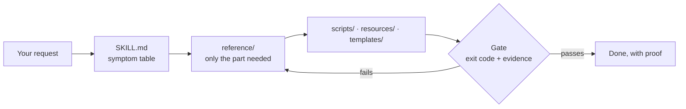

<div align="center">

<h1>unity-dev-skills</h1>

<p><b>Unity 6 skills that make Claude Code and Codex work like a careful Unity developer — and prove each step.</b></p>

<p><i>60+ skills from the first idea to a build on a real phone.</i></p>

<p>
<a href=".claude-plugin/plugin.json"></a>
<a href="https://github.com/tipoLi5890/unity-dev-skills/actions/workflows/ci.yml"></a>
<a href="LICENSE"></a>


</p>

<p><b>English</b> · <a href=".github/README.zh-TW.md">繁體中文</a> · <a href=".github/README.zh-CN.md">简体中文</a> · <a href=".github/README.ja.md">日本語</a></p>


</div>

## Try asking

| You say | What happens |
|---|---|
| "The runner's jump doesn't always register." | `unity-input` latches each press in `Update`, spends it once in `FixedUpdate`, and a journey test proves one press gives one jump |
| "The sentry sees the runner through walls." | `unity-game-ai` builds the vision cone from distance, angle and one line-of-sight cast; a journey proves the chase starts only after sight |
| "It hitches when the third pickup spawns." | `unity-profiling` samples that moment in 90-frame windows (median, p95, worst), reads the work and GC counters, and compares before and after |
| "Turn this drawing of the runner into a character that runs in Unity." | `game-character-pipeline` sets the quality target and route first, then hands stages S0–S13 — views, 3D, rig, motion, import — to the skill that owns each, gated |
| "Show me the courier run before we write code." | `unity-game-brief` builds a timed simulated-gameplay preview from the game's own rule constants, with every sound logged |
| "Put it on my iPhone — without opening Xcode." | `unity-ios-build` runs a headless build, a compile gate, signing with what your Mac holds, a `devicectl` install, and reads the app's console |

## Install

```bash
claude plugin marketplace add tipoLi5890/unity-dev-skills
claude plugin install unity-dev@unity-dev
```

**Codex** reads the same tree: point it at `.agents/plugins/marketplace.json`, or at
`.codex-plugin/plugin.json` for the plugin on its own. Both are generated from the Claude-format
manifests, so they cannot come to say anything different.

**Or copy** the skills straight into a project: `skills/*` into `<project>/.claude/skills/`.

### Requirements

- **Required:** Claude Code or Codex; a Unity 6 project; Python 3.10 or newer for the scripts, with
  NumPy and Pillow for the ones that read images or audio.
- **Optional, for the asset and character pipeline only:** Blender, in a version your Auto-Rig Pro
  release supports (`character-autorig` explains); Auto-Rig Pro under your own licence; a
  self-hosted ComfyUI on a GPU machine; the `codex` CLI for 2D art.
- **Optional, for video:** ffmpeg, for anything that writes one (previews, reels, sprites from video).
- **Optional, for devices:** a Mac with Xcode 15 or newer for iOS; the Android SDK for Android.

Work inside Unity needs none of the asset-pipeline or video tools; a phone build needs only what
that platform already asks for.

## See it work

### From one drawing to a moving, rigged character

<div align="center">

<p><sub>Top: a generated two-camera video. Bottom: the character's rig, driven by the motion solved from it.</sub></p>
</div>

[`codex-visual`](skills/codex-visual/SKILL.md) →
[`comfyui-asset-generation`](skills/comfyui-asset-generation/SKILL.md) →
[`character-autorig`](skills/character-autorig/SKILL.md) →
[`humanoid-motion`](skills/humanoid-motion/SKILL.md) →
[`unity-rigged-character`](skills/unity-rigged-character/SKILL.md)

The 3D model, the rig and the motion are made on your own machines; only the 2D art goes through
the `codex` CLI. The two-camera solve is ported from [anymove](https://github.com/patch-gg/anymove) (Apache-2.0;
see [THIRD_PARTY_NOTICES.md](THIRD_PARTY_NOTICES.md)).
The video is machine-generated with MiniMax H3, run locally on its open weights under the MiniMax H3
Community License Agreement.

## How it works



- **Lands on the right method from your words.** Each skill opens with a table of symptoms in
  plain language, and three start-here skills route any gameplay, UI or character request.
- **Runs code, not advice.** 100+ Python scripts, 170+ C# files and 50+ templates you copy into
  your project instead of retyping notes.
- **Proves it.** Methods end in a check you can read: a probe snapshot, a journey test, a re-imported FBX,
  a device log.
- **Light on context, self-contained.** A `SKILL.md` only routes; depth loads when the situation
  needs it. No other plugin is required: skills hand off to each other through their Scope sections.

## Skills

> [!TIP]
> Not sure where to start? Use `unity-gameplay` for any gameplay request, `unity-game-ui` for any
> UI request, and `game-character-pipeline` for a rigged character made from an image.

<details>
<summary><b>Every stage — terminal & search</b> — the Unity CLI, and finding anything in a project</summary>

| Skill | Use it when |
|---|---|
| [`unity-cli`](skills/unity-cli/SKILL.md) | Unity from a terminal, with exit codes that say whether a retry is honest |
| [`unity-search`](skills/unity-search/SKILL.md) | "Where is it, what references it?" answered as one Unity Search query |

</details>

<details>
<summary><b>Concept</b> — the brief, day-one project setup, gameplay routing</summary>

| Skill | Use it when |
|---|---|
| [`unity-game-brief`](skills/unity-game-brief/SKILL.md) | An idea becomes a brief, a locked look, a gameplay preview, one playable interaction |
| [`unity-new-project`](skills/unity-new-project/SKILL.md) | Day-one decisions that are costly to retrofit, plus tests that run without the Editor |
| [`unity-gameplay`](skills/unity-gameplay/SKILL.md) | **Start here** for any gameplay request: it fingerprints the project and routes the work |

</details>

<details>
<summary><b>3C prototype</b> — input, camera, 2D and 3D controllers, animation, physics, play harness</summary>

| Skill | Use it when |
|---|---|
| [`unity-input`](skills/unity-input/SKILL.md) | A jump that goes missing or fires twice; gameplay reads one input struct |
| [`unity-camera`](skills/unity-camera/SKILL.md) | A camera that jitters, shows outside the level or clips through walls |
| [`unity-2d-controller`](skills/unity-2d-controller/SKILL.md) | A 2D character that slides down slopes or sticks to walls: one kinematic motor |
| [`unity-3d-controller`](skills/unity-3d-controller/SKILL.md) | `isGrounded` flickers or jump height changes with frame rate: one 3D motor |
| [`unity-animation`](skills/unity-animation/SKILL.md) | An Animator stuck in a state or an attack that plays by itself |
| [`unity-physics-2d`](skills/unity-physics-2d/SKILL.md) | A 2D collision or trigger that never fires, triaged in Box2D's own vocabulary |
| [`unity-physics-3d`](skills/unity-physics-3d/SKILL.md) | A collision or trigger that never fires, or a ball your game integrates itself |
| [`unity-play-harness`](skills/unity-play-harness/SKILL.md) | Make the game drivable: a one-line probe snapshot and journey tests that assert invariants |

</details>

<details>
<summary><b>Vertical slice — 2D world</b> — levels as data, grid boards, tile palettes, draw order and 2D lights</summary>

| Skill | Use it when |
|---|---|
| [`unity-2d-level`](skills/unity-2d-level/SKILL.md) | A 2D level as data, with seeded generation that checks every pickup is reachable |
| [`unity-2d-grid`](skills/unity-2d-grid/SKILL.md) | Board logic for tactics and tile puzzles on square, isometric or hex grids |
| [`unity-tilemap`](skills/unity-tilemap/SKILL.md) | Tiles that won't connect as you paint: RuleTiles from your sheet, palettes per grid |
| [`unity-2d-rendering`](skills/unity-2d-rendering/SKILL.md) | A sprite drawn behind the wrong one, or a `Light2D` that turns everything black |

</details>

<details>
<summary><b>Vertical slice — 3D world</b> — greybox to metrics, URP lighting, NavMesh agents</summary>

| Skill | Use it when |
|---|---|
| [`unity-3d-level`](skills/unity-3d-level/SKILL.md) | A 3D greybox built from a metrics sheet and proven by a walk journey |
| [`unity-lighting`](skills/unity-lighting/SKILL.md) | A bake that did nothing, or a character black beside baked walls, on URP |
| [`unity-navigation`](skills/unity-navigation/SKILL.md) | An agent that won't move or walks through walls: NavMesh, links, transform ownership |

</details>

<details>
<summary><b>Vertical slice — systems</b> — doors and pickups, damage, enemy AI, scenes and saves</summary>

| Skill | Use it when |
|---|---|
| [`unity-interaction`](skills/unity-interaction/SKILL.md) | "Press E to open" that flickers or opens twice: one target, one prompt |
| [`unity-combat`](skills/unity-combat/SKILL.md) | A swing that hits twice or a shot through the sentry: one hit each |
| [`unity-game-ai`](skills/unity-game-ai/SKILL.md) | An enemy that sees through walls or never gives up: perception on a budget |
| [`unity-scene-flow`](skills/unity-scene-flow/SKILL.md) | Duplicated managers or a corrupted save: a Boot scene and versioned atomic saves |

</details>

<details>
<summary><b>Vertical slice — UI</b> — UI routing and HUDs, uGUI, UI Toolkit</summary>

| Skill | Use it when |
|---|---|
| [`unity-game-ui`](skills/unity-game-ui/SKILL.md) | **Start here** for any UI request: it detects the UI system and routes |
| [`unity-ui-ugui`](skills/unity-ui-ugui/SKILL.md) | A Canvas UI that renders nothing: six checks, then anchors and Layout Groups |
| [`unity-ui-toolkit`](skills/unity-ui-toolkit/SKILL.md) | A USS property that silently does nothing, plus UXML, flex layout and binding |

</details>

<details>
<summary><b>Production — assets</b> — asset ledger, 3D models, rigged characters, sprites, audio, languages</summary>

| Skill | Use it when |
|---|---|
| [`art-asset-registry`](skills/art-asset-registry/SKILL.md) | Which generated asset came from where, and what went stale: one append-only ledger |
| [`unity-3d-models`](skills/unity-3d-models/SKILL.md) | A 3D model into the game, at a budget picked under the game camera |
| [`unity-rigged-character`](skills/unity-rigged-character/SKILL.md) | A rigged FBX that T-poses in Unity: import, Avatar, Animator and gameplay rig |
| [`unity-2d-sprites`](skills/unity-2d-sprites/SKILL.md) | Sprite sheets sliced from script, and frames turned into a playable clip |
| [`unity-2d-animation`](skills/unity-2d-animation/SKILL.md) | Skeletal 2D characters from a PSB, with skins and equipment swapped at runtime |
| [`unity-2d-pixel-perfect`](skills/unity-2d-pixel-perfect/SKILL.md) | Pixel art that renders soft, shimmers as the camera moves or shows seams |
| [`unity-sprite-atlas`](skills/unity-sprite-atlas/SKILL.md) | Sprites that should share a draw call, packed into V2 atlases from script |
| [`unity-audio`](skills/unity-audio/SKILL.md) | Audio memory and CPU cut without the game sounding worse; it reports before reimporting |
| [`unity-localization`](skills/unity-localization/SKILL.md) | Shipping in more than one language, including the CJK font pipeline where it breaks |

</details>

<details>
<summary><b>Production — AI asset generation</b> — the character stage order, 2D art, audio, video and 3D, rigging and motion</summary>

| Skill | Use it when |
|---|---|
| [`game-character-pipeline`](skills/game-character-pipeline/SKILL.md) | **Start here** for a rigged character from an image: stages S0–S13, each gated |
| [`codex-visual`](skills/codex-visual/SKILL.md) | 2D art through the `codex` image model, kept on-style by one art bible |
| [`comfyui-asset-generation`](skills/comfyui-asset-generation/SKILL.md) | Music, SFX, video and 3D models from your own ComfyUI, one job each |
| [`sprite-from-video`](skills/sprite-from-video/SKILL.md) | One character still turned into transparent sprite loops through a generated video |
| [`blender-character-rig`](skills/blender-character-rig/SKILL.md) | An image-to-3D character rigged in Blender, its FBX proven by re-import |
| [`blender-retarget`](skills/blender-retarget/SKILL.md) | Stock clips onto your Blender rig, gated on slide, jitter and pops |
| [`character-autorig`](skills/character-autorig/SKILL.md) | A humanoid rigged locally with your own Auto-Rig Pro, in one headless command |
| [`humanoid-motion`](skills/humanoid-motion/SKILL.md) | A move as a clip, solved from a two-camera video straight onto the skeleton |

</details>

<details>
<summary><b>Polish & optimisation</b> — game feel, URP, migration, profiling, scene cost, verification</summary>

| Skill | Use it when |
|---|---|
| [`unity-game-feel`](skills/unity-game-feel/SKILL.md) | A hit with no impact: one feedback row per gameplay event, with a budget |
| [`unity-render-urp`](skills/unity-render-urp/SKILL.md) | Post-processing that will not appear, and Render Graph features reviewed before shipping |
| [`unity-urp-migration`](skills/unity-urp-migration/SKILL.md) | Built-in to URP in five gated phases, or a half-moved project diagnosed |
| [`unity-profiling`](skills/unity-profiling/SKILL.md) | What a slow or uneven frame is doing, as 90-frame windows you compare |
| [`unity-scene-optimisation`](skills/unity-scene-optimisation/SKILL.md) | The fix once a counter names the cost, read back on the same counter |
| [`unity-debug`](skills/unity-debug/SKILL.md) | Verifying a change you cannot see — after proving the harness tells the truth |

</details>

<details>
<summary><b>Shipping</b> — real-phone tests, Android, iOS, web</summary>

| Skill | Use it when |
|---|---|
| [`unity-device-testing`](skills/unity-device-testing/SKILL.md) | Acceptance on a real phone: an agent drives, a person does the physical step |
| [`unity-android-release`](skills/unity-android-release/SKILL.md) | A signed APK or AAB, proven by reading the artifact back |
| [`unity-ios-build`](skills/unity-ios-build/SKILL.md) | A Unity project to a running iPhone app, without opening Xcode |
| [`unity-web-release`](skills/unity-web-release/SKILL.md) | A WebGL or WebGPU build small and fast enough that people wait for it |

</details>

<details>
<summary><b>Backend & commerce</b> — backend discipline, Gaming Services, purchases, ads, multiplayer, voice</summary>

| Skill | Use it when |
|---|---|
| [`unity-live-services`](skills/unity-live-services/SKILL.md) | Putting a game on a backend safely, with the offline path designed first |
| [`unity-ugs`](skills/unity-ugs/SKILL.md) | A service that throws because nothing initialised: Gaming Services in the right order |
| [`unity-iap`](skills/unity-iap/SKILL.md) | Content granted twice or not at all: In-App Purchasing v5, call by call |
| [`unity-ads-levelplay`](skills/unity-ads-levelplay/SKILL.md) | No ads, or a build broken by ad dependencies: LevelPlay, consent before init |
| [`unity-monetization`](skills/unity-monetization/SKILL.md) | Purchase and ad SDKs that break the build, the manifest or the store declaration |
| [`unity-multiplayer`](skills/unity-multiplayer/SKILL.md) | Choosing the topology first, and keeping voice chat off another feature's microphone |
| [`unity-multiplayer-services`](skills/unity-multiplayer-services/SKILL.md) | How players get into a game together, from join codes to host migration |
| [`unity-vivox`](skills/unity-vivox/SKILL.md) | A voice join that succeeds while nobody hears: Vivox chat, sign-in to push-to-talk |

</details>

## Contributing

Tooling, checks and repo rules: [.github/CONTRIBUTING.md](.github/CONTRIBUTING.md). What each release contains: [CHANGELOG.md](CHANGELOG.md).

## Licence

MIT — see [LICENSE](LICENSE). Code ported from other projects keeps its own licence: [THIRD_PARTY_NOTICES.md](THIRD_PARTY_NOTICES.md).
